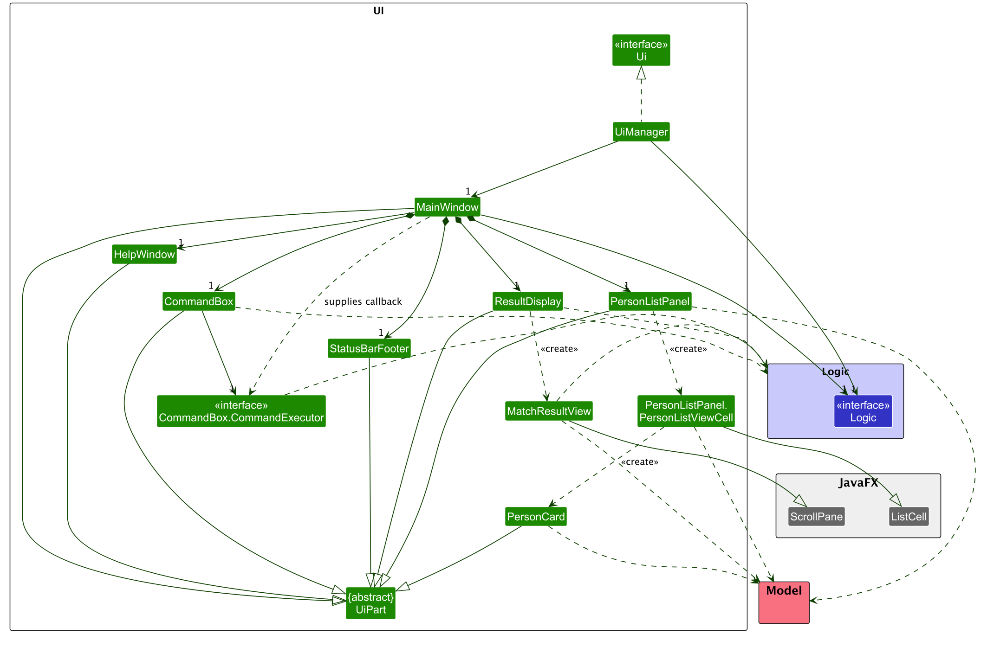
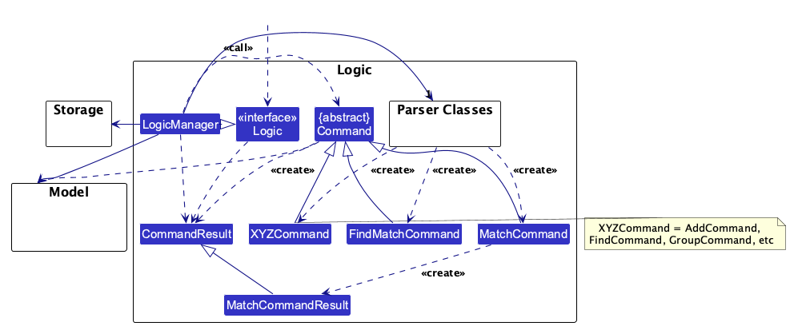
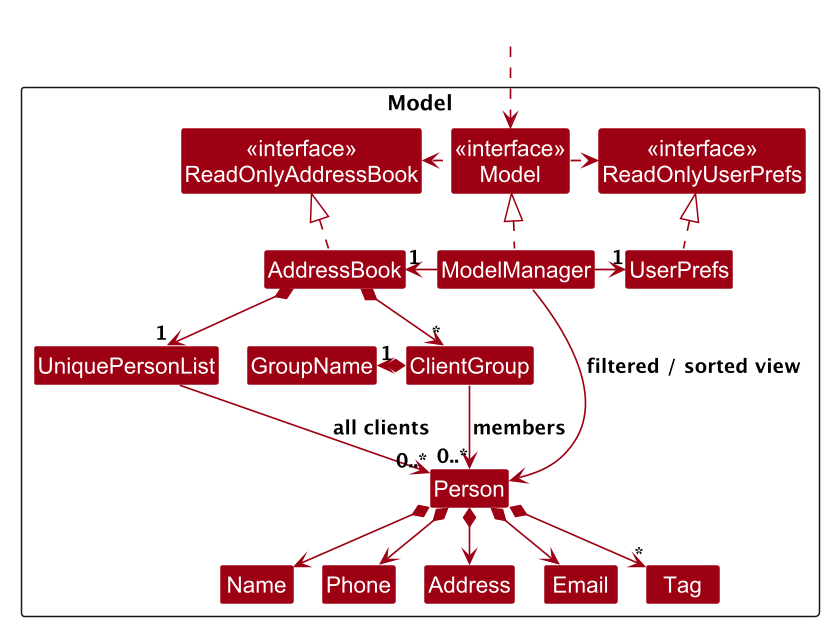
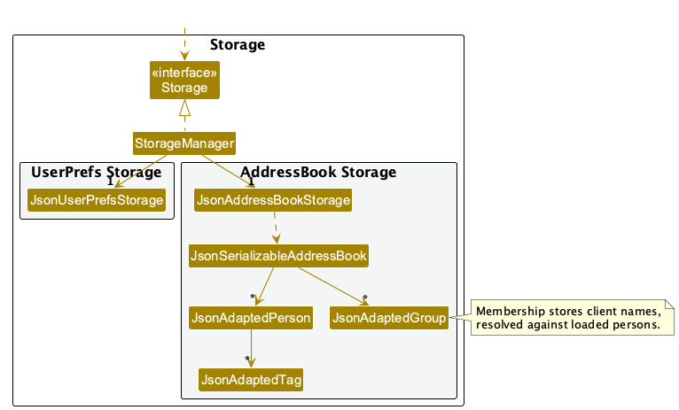
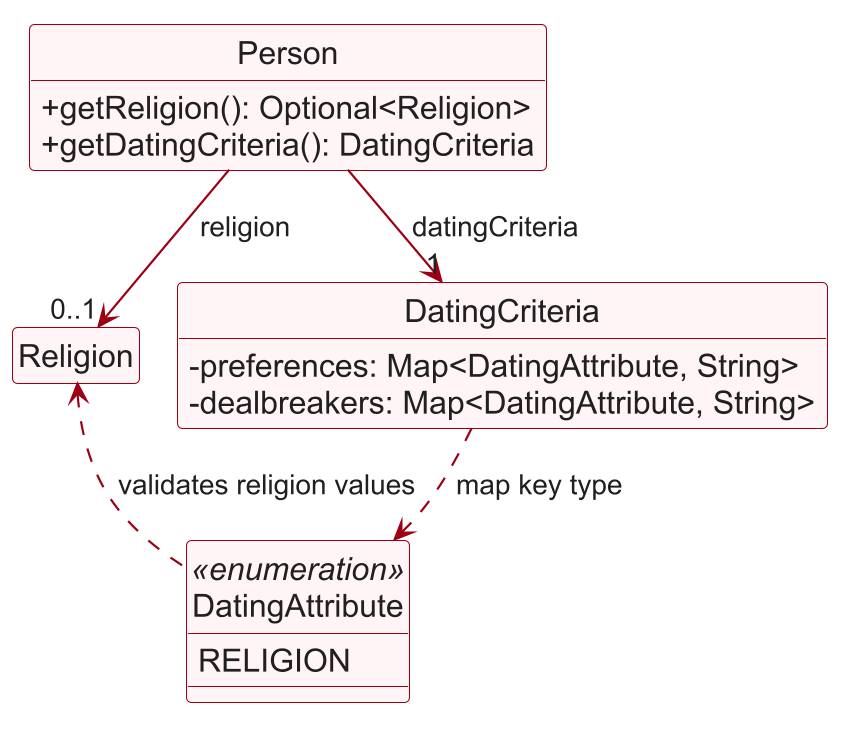

* Table of Contents
{:toc}

--------------------------------------------------------------------------------------------------------------------

## **Acknowledgements**

* _{List the sources of reused or adapted ideas, code, documentation, and third-party libraries here, with links to the originals.}_
* The smoking-status increment follows the model, storage, and UI integration approach in the [SE-EDU Adding a Command tutorial](https://se-education.org/guides/tutorials/ab3AddRemark.html), adapted to the existing `add` and `edit` commands.
* The relationship-goal increment follows the model, storage, and UI integration approach in the [SE-EDU Adding a Command tutorial](https://se-education.org/guides/tutorials/ab3AddRemark.html), adapted to the existing `add` and `edit` commands. Its goal categories are adapted from the relationship types offered by the Hinge dating app.

--------------------------------------------------------------------------------------------------------------------

## **Setting up, getting started**

Refer to the guide [_Setting up and getting started_](SettingUp.md).

--------------------------------------------------------------------------------------------------------------------

## **Design**

:bulb: **Tip:** The `.puml` files used to create diagrams are in `docs/diagrams`. Refer to the [_PlantUML Tutorial_ at se-edu/guides](https://se-education.org/guides/tutorials/plantUml.html) to learn how to create and edit diagrams.

### Architecture

The ***Architecture Diagram*** given above explains the high-level design of the App.

The following provides a quick overview of the main components and their interactions.

**Main components of the architecture**

**`Main`** (consisting of classes [`Main`](https://github.com/se-edu/addressbook-level3/tree/master/src/main/java/seedu/address/Main.java) and [`MainApp`](https://github.com/se-edu/addressbook-level3/tree/master/src/main/java/seedu/address/MainApp.java)) is in charge of the app launch and shut down.
* At app launch, it initializes the other components in the correct sequence, and connects them up with each other.
* At shut down, it shuts down the other components and invokes cleanup methods where necessary.

The bulk of the app's work is done by the following four components:

* [**`UI`**](#ui-component): The UI of the App.
* [**`Logic`**](#logic-component): The command executor.
* [**`Model`**](#model-component): Holds the data of the App in memory.
* [**`Storage`**](#storage-component): Reads data from, and writes data to, the hard disk.

[**`Commons`**](#common-classes) represents a collection of classes used by multiple other components.

**How the architecture components interact with each other**

The *Sequence Diagram* below shows how the components interact with each other for the scenario where the user issues the command `delete 1`.

Each of the four main components (also shown in the diagram above),

* defines its *API* in an `interface` with the same name as the Component.
* provides its functionality through a concrete `{Component Name}Manager` class that implements the corresponding API interface.

For example, the `Logic` component defines its API in `Logic.java` and implements it in `LogicManager.java`. Other components interact with a component through its interface rather than its concrete class, preventing them from coupling to that component's implementation, as illustrated in the following partial class diagram.

The sections below give more details of each component.

### UI component

The **API** of this component is specified in [`Ui.java`](https://github.com/se-edu/addressbook-level3/tree/master/src/main/java/seedu/address/ui/Ui.java)

The UI consists of a `MainWindow` and its parts, such as `CommandBox`, `ResultDisplay`, `PersonListPanel`, and `StatusBarFooter`. All of these, including `MainWindow`, inherit from the abstract `UiPart` class, which captures common behavior among classes that represent visible GUI parts.

The `UI` component uses the JavaFX UI framework. The layouts of these UI parts are defined in matching `.fxml` files in `src/main/resources/view`. For example, [`MainWindow.fxml`](https://github.com/se-edu/addressbook-level3/tree/master/src/main/resources/view/MainWindow.fxml) specifies the layout of [`MainWindow`](https://github.com/se-edu/addressbook-level3/tree/master/src/main/java/seedu/address/ui/MainWindow.java).

The `UI` component,

* executes user commands using the `Logic` component.
* listens for changes to `Model` data so that the UI can be updated with the modified data.
* keeps a reference to the `Logic` component, because the `UI` relies on the `Logic` to execute commands.
* depends on some classes in the `Model` component because it displays `Person` objects from the model.

### Logic component

**API** : [`Logic.java`](https://github.com/se-edu/addressbook-level3/tree/master/src/main/java/seedu/address/logic/Logic.java)

Here's a (partial) class diagram of the `Logic` component:

The sequence diagram below illustrates the interactions within the `Logic` component, taking `execute("delete 1")` API call as an example.

:information_source: **Note:** The lifeline for `DeleteCommandParser` should end at the destroy marker (X), but due to a limitation of PlantUML, it continues to the end of the diagram.

How the `Logic` component works:

1. `Logic` passes the command text to `AddressBookParser`. Commands with arguments use a command parser (for example, `DeleteCommandParser`); argument-free commands such as `list` and `help` are constructed directly.
1. This results in a `Command` object (more precisely, an object of one of its subclasses e.g., `DeleteCommand`) which is executed by the `LogicManager`.
1. The command can communicate with the `Model` when it is executed (e.g. to delete a person). 
   Note that although this is shown as a single step in the diagram above for simplicity, the code can require several interactions between the command object and the `Model` to complete the operation.
1. The result of the command execution is encapsulated as a `CommandResult` object which is returned from `Logic`.

`MatchCommand` compares two clients, given by displayed index or by name, and returns a `MatchCommandResult`, a subclass of
`CommandResult` carrying structured match details for the UI. `FindMatchCommand`, created by
`FindCommandParser` for `find match/INDEX`, filters and ranks candidates and returns an ordinary
`CommandResult`. The diagram shows these separately; `XYZCommand` stands for the other concrete commands.

Here are the other classes in `Logic` (omitted from the class diagram above) that are used for parsing a user command:

How the parsing works:
* For commands with arguments, `AddressBookParser` delegates to the appropriate command parser, which creates the command object. Commands without arguments, such as `list` and `help`, are constructed directly. The resulting object is returned as a `Command`.
* All `XYZCommandParser` classes, such as `AddCommandParser` and `DeleteCommandParser`, implement the `Parser` interface so they can be treated similarly where appropriate, for example during testing.

### Model component
**API** : [`Model.java`](https://github.com/se-edu/addressbook-level3/tree/master/src/main/java/seedu/address/model/Model.java)

The `Model` component,

* stores the address book data i.e., all `Person` objects (which are contained in a `UniquePersonList` object).
* stores named `ClientGroup` objects in `AddressBook`. Each immutable group has a `GroupName` and references
  existing persons; membership does not duplicate client records or reuse ordinary tags. Dating attributes
  and criteria are omitted from this overview diagram for readability.
* stores the `Person` objects selected by the current filter, such as search results, in a separate _filtered_ list. It exposes this list as an unmodifiable `ObservableList<Person>` that the UI can observe and bind to, so the UI updates when the list changes.
* stores a `UserPrefs` object that represents the user’s preferences (currently, just the GUI settings). This is exposed to the outside as a `ReadOnlyUserPrefs` object.
* does not depend on any of the other three components (as the `Model` represents data entities of the domain, they should make sense on their own without depending on other components)

:information_source: **Note:** The alternative, arguably more object-oriented, design below keeps a unique list of tags in `AddressBook`, and each `Person` references tags from that list. This lets `AddressBook` maintain one `Tag` object per unique tag instead of each `Person` holding its own `Tag` objects. 

### Storage component

**API** : [`Storage.java`](https://github.com/se-edu/addressbook-level3/tree/master/src/main/java/seedu/address/storage/Storage.java)

The `Storage` component,
* can save both address book data and user preference data in JSON format, and read them back into corresponding objects.
* is implemented by `StorageManager`, which delegates the actual JSON file access to `JsonAddressBookStorage` and `JsonUserPrefsStorage` (one class per data file).
* uses `JsonSerializableAddressBook` to store persons and named groups through `JsonAdaptedPerson`
  and `JsonAdaptedGroup`. Group membership is stored as client names and resolved against the loaded
  persons, rather than duplicating client records. The person adapter also stores dating attributes
  and the preference and dealbreaker maps.
* depends on some classes in the `Model` component (because the `Storage` component's job is to save/retrieve objects that belong to the `Model`)

### Common classes

Classes used by multiple components are in the `seedu.address.commons` package.

--------------------------------------------------------------------------------------------------------------------

## **Implementation**

This section describes some noteworthy details on how certain features are implemented.

### Named client groups

`grp NAME add INDEX...`, `grp NAME remove INDEX...` and `grp NAME matches INDEX` are parsed by
`GroupCommandParser` into `GroupCommand`. `ShowGroupCommandParser` handles `show NAME`.
Group names use the shared `GroupName` validation: 1–30 ASCII letters, digits, hyphens or underscores,
with an alphanumeric first character. Equality and hashing use a `Locale.ROOT` lowercase key, while
display and storage retain the original spelling. Operations and command words remain case-sensitive.

`ClientGroup` is an immutable value containing a name and an immutable, duplicate-free membership list.
`AddressBook` owns the observable group list and exposes an unmodifiable view. `setGroups` snapshots and
validates the complete replacement (unique group names and members present in the book) before publishing it.

The command flow is:

1. Parse the operation and distinct positive indexes. Compare their numeric values, since `Index` does not
   implement value-based hashing.
2. Resolve **all** indexes against the displayed list before any mutation. This matters when removing multiple
   members from a shown group: the first removal must not shift the meaning of later indexes.
3. Build a replacement membership list and validate the operation. Add creates a missing group; remove
   requires an existing group. Any already-present member on add or absent member on remove rejects the
   whole command. Single-member groups and empty groups after removal are valid.
4. Publish once through `Model.setGroups`. `LogicManager` then saves clients and groups in the same JSON file.

Match-based creation uses `MatchAssessment` for every other client in the full address book, excluding
`INCOMPATIBLE` outcomes and the selected source. It shares the eligibility rule of `FindMatchCommand`,
including insufficient-information candidates, but does not apply its preference-score ordering. An existing
group or no candidates is an error. Membership is a snapshot and is not recomputed on later attribute edits.

`ModelManager.showGroup` clears any match-result comparator and filters by current membership in address-book
order. A group-list listener reapplies the predicate after membership changes. Normal list/find operations
clear the selected-group state. `AddressBook.setPerson` replaces membership references when immutable
persons are edited; `removePerson` removes references but retains empty groups. Bulk person replacement
prunes obsolete references. `resetData` validates a complete copy before replacing persons and groups;
clearing the book therefore clears groups too. Existing add/edit commands still restore the full list.

`JsonAdaptedGroup` stores `name` and `memberNames`, resolving members against the loaded persons' unique
names. This uses the existing name-based client identity and is independent of displayed or file-array
positions. App-driven renames are saved consistently; manual JSON renames must update group references.
Missing groups in legacy files default to an empty collection. Malformed entries, duplicate group names
or duplicate/dangling membership references follow the existing `IllegalValueException` storage error path.

`Logic.getGroupList` exposes group changes to `PersonListPanel`, which refreshes its cells when memberships
change. `PersonCard` displays alphabetically ordered group chips after a **Groups** label, separately from tag chips,
in a strip below the card's columns that is hidden when the client has no tags or groups. No additional client fields or external dependencies are required.

Automated tests cover value validation/immutability, atomic failures, filtered and sorted displayed indexes,
matching snapshots, edits/deletion/clear, shown-group updates, persistence round trips, reordered JSON
persons and legacy/malformed files. Group rename/delete and an all-groups listing command are deferred.

### Prefixed name search

`FindCommandParser` tokenizes `n/` together with the other search prefixes (`age/`, `g/`, `r/`, `rg/`, `s/` and
`match/`) and counts how many are present. Exactly one prefix and an empty preamble are required, so `find Alice`,
`find Alice g/m` and `find n/Alice age/25` are all rejected with the usage message. This replaces AB3's bare-keyword
form and removes the special case that previously treated any unprefixed text as a name search.

`parseNameSearch` trims the `n/` value, rejects a blank value with a specific message, and rejects values containing
`/` so that a mistyped prefix (e.g. `n/Alice x/1`) is never searched for as a name. The remaining text is split on
whitespace into a `NameContainsKeywordsPredicate`, so matching is unchanged: whole-word, case-insensitive, and
any keyword may match. A repeated `n/` is reported through the shared duplicate-prefix message.

Names such as `Ravi s/o Kumar` contain `/`, so a quoted value is searched as one phrase. `ArgumentTokenizer` reads
`n/"..."` as a single value, ignoring prefixes inside the quotes, and removes the quotes. Because name search is the
only mode left at this point, `FindCommandParser` checks whether the text after `n/` starts with `"`. If so, the
value becomes a `NameContainsPhrasePredicate`, which accepts `/` and keeps a client when the phrase's words appear
consecutively in the name as whole words, ignoring case. An unquoted `/` is still rejected, with a hint to quote.

### Recording Dating Data

#### Recording profile attributes

##### Client gender

`Person` stores a `Gender` enum (`MAN`, `WOMAN`, `NON_BINARY`, or `UNSPECIFIED`). Its command and JSON values are `m`, `w`, `nb`, and the empty string respectively. `Gender.parseValue` is the shared validation and normalization method; `ParserUtil.parseGender` translates invalid input into the existing `ParseException` flow. Gender is included in full person equality, but does not change the name-based duplicate-client check.

* `AddCommandParser` accepts optional `g/`; omitted or empty values become `UNSPECIFIED`.
* `EditPersonDescriptor` uses an absent gender for “keep existing” and `UNSPECIFIED` for “clear”. `EditCommand` preserves gender when another field is edited and uses the displayed client index as before.
* `FindCommandParser` retains name-only search and parses one `g/` into a set of genders. It rejects repeated prefixes, duplicate normalized values, unknown values and empty list items. Empty `g/` selects all three specified genders. `GenderMatchesPredicate` tests set membership, and `FindCommand` accepts `Predicate<Person>` so name, age and gender searches share the existing execution path. Age searches retain upstream's exact-age and inclusive-range validation.
* `JsonAdaptedPerson` saves the canonical gender code. Missing, null or empty gender values load as `UNSPECIFIED`, so valid records containing the required age need no gender migration. Invalid non-empty values use the existing storage error handling.
* `PersonCard` and command feedback display the full gender label, including “Unspecified”.

Name, age and gender are separate search modes. Combined-trait searches remain deferred. The required age and optional smoking fields from upstream are preserved when adding, editing and saving gender.

Tests cover gender value validation, parser rules, full command execution, filtering, editing the correct displayed client, persistence, older JSON records and unchanged data/results after invalid commands. Existing name-search tests are retained. Shared builders and command helpers carry gender so they do not silently discard it.

##### Recording smoking status

The optional `s/` parameter in `add` and `edit` records a client's own smoking habit.
`SmokingStatus` stores a normalized `yes` or `no`; its empty value represents information not yet recorded,
not a non-smoker. The parsers reject invalid and repeated `s/` parameters, and empty ones in `add` and `find`.
`EditCommandParser` maps an empty `s/` to `SmokingStatus.UNSPECIFIED`, clearing the status the same way an empty
`g/` or `r/` clears gender or religion. An unquoted ` s/` inside another value, as in `n/Ravi s/o Kumar`, is read as
the smoking prefix; [quoted values](#quoted-argument-values) avoid this. `ParserUtil.MESSAGE_INVALID_SMOKING_STATUS`
suggests quoting for command input, while storage keeps the shorter `SmokingStatus.MESSAGE_CONSTRAINTS`.

`Person` includes smoking status in full equality and hashing, while its existing name-based identity rule is unchanged.
`EditPersonDescriptor` carries an optional update; edits to other fields preserve the stored status.
`JsonAdaptedPerson` saves the `smokingStatus` string and reads absent or null fields in older JSON files as unspecified.
An empty stored string also means unspecified. Other invalid stored values are rejected using the existing storage-error path.
The person card and command feedback display the status. Missing information is shown as `not set` on the card and
`Not specified` in command feedback.

This increment supplies personal-characteristic data for later filtering and matching work.
Partner criteria and matching are covered under [Pairwise matching](#pairwise-matching).
Clearing a recorded smoking status is not supported.

### Quoted argument values

`ArgumentTokenizer` scans the arguments once, left to right, recording the earliest prefix occurrence each time.
When the first non-space character after a prefix is `"`, the value is quoted: the scan skips to the next `"` that
is followed by whitespace or the end of the string, so prefixes inside the quotes, such as `s/` in
`n/"Ravi s/o Kumar"`, are not recognized. The quotes and surrounding spaces are removed from the stored value.
A missing closing quote (`MESSAGE_UNCLOSED_QUOTE`) or text between the closing quote and the next prefix
(`MESSAGE_TEXT_AFTER_QUOTE`) raises a `ParseException`, so `tokenize` now declares it. Quotes later in a value,
and in the preamble, are kept as typed.

Every command that uses the tokenizer gets this behaviour, including values inside `{...}` and `<...>`.
`DatingCriteriaParser` still runs first, so quotes do not protect `{`, `}`, `<` or `>`.
`Name` allows `/` after its first character, so quoted names such as `Ravi s/o Kumar` pass validation.
`FindCommandParser` still rejects name keywords that contain `/`, because a keyword such as `s/o` usually means
a mistyped prefix; such clients are found by their other name words.

### Application data sandbox

#### Recording preference and dealbreaker attributes

##### Religion attributes

`Religion` accepts only the categories listed in the User Guide. It strips leading and trailing
whitespace, collapses repeated internal whitespace, and compares names without regard to case.
Each valid input is stored and displayed using the category's canonical spelling: for example,
`r/jAiNiSm` becomes `Jainism`. Other spellings (such as a misspelling or a different apostrophe)
and an `Other` category are not accepted. A finite list makes values directly comparable for
search and matching without inventing a meaning for arbitrary free text.

`AddCommandParser` and `EditCommandParser` first use the shared `DatingCriteriaParser`
to extract at most one non-nested `{...}` preference environment and one non-nested
`<...>` dealbreaker environment. They tokenize the remaining outer arguments for the
client's own fields. Thus outer `r/` records own religion, `{r/Buddhism}` records a soft
partner preference for Buddhism, and `<r/Islam>` records Islam as an excluded partner
religion: the partner **must not have** it. Exclusion is not a requirement to have that
religion. These commands record criteria; [pairwise matching](#pairwise-matching) evaluates them.

The own religion is optional in `Person`; absent means **unknown**, not the explicit
`No religion` category. `add` rejects a blank outer `r/`; `edit` supports clearing only
the own field with an empty outer `r/`. Omitting it preserves the own religion. One
`r/` is permitted in each environment independently of the outer `r/`. Blank religion
values inside environments, duplicate prefixes within an environment, repeated
environments and nested or unbalanced delimiters are rejected.

#### Internal representation

`DatingAttribute.RELIGION` normalizes criteria using the same `Religion` value type as
the own field. `Person` holds an immutable `DatingCriteria` with separate preference
and dealbreaker maps indexed by `DatingAttribute`. The resulting criteria must not
prefer and exclude the same normalized gender, smoking status, religion, or relationship
goal. Preferred and excluded age ranges must not overlap. These checks also apply when
an edit updates only one bucket and retains the other. Age ranges accept spaces around
the hyphen, such as `age/25 - 30`. The own religion is independent: it may equal or
differ from either partner criterion. A failed add or edit leaves stored records unchanged.

The class diagram below focuses on the religion-related model. Unrelated `Person`
members and the other `DatingAttribute` enum values are omitted.

The `0..1` multiplicity represents an unknown or recorded own religion, while
`DatingCriteria` is always present, even when both maps are empty. Religion criteria
are canonical strings in those maps, not references to the client's own `Religion`.
The dashed dependencies show the map key type and the shared religion validation;
they do not represent additional stored associations.

`DatingCriteriaParser.ParsedCriteria` distinguishes an omitted environment from an
explicitly empty one. `EditPersonDescriptor` carries these optional bucket updates;
`EditCommand` preserves an omitted bucket and merges a non-empty update by value for
multi-valued attributes. For example, `{r/Buddhism}` adds Buddhism to the preferred religions
while preserving age, smoking and relationship-goal preferences; an already recorded value is
left in place and reported as a warning. `{}` clears all preferences and `<>`
clears all exclusions/dealbreakers, without changing the own religion or the other bucket.
Unrelated person fields are preserved unless separately supplied in the edit.

`ParserUtil.rejectRemovedReligionCriteria` explicitly rejects the obsolete outer
`rp/`, `rr/` and `rx/` prefixes, including blank values; the shared environment parser
also rejects them inside environments. This prevents a legacy criteria command from
silently becoming part of another field.

`JsonAdaptedPerson` saves the canonical own-religion name and treats a missing or null
own-religion property as unknown. It persists criteria via `DatingCriteria` as the
`preferences` and `dealbreakers` maps, using the key `religion` and a list of canonical categories,
for example `"preferences": {"religion": ["Buddhism", "Jainism"]}` and
`"dealbreakers": {"religion": ["Islam"]}`. `DatingCriteria.fromStorage` restores these
maps and accepts the old single-string format; older valid records without them load with empty criteria. Invalid religion
criteria, including null map values and a normalized preference/exclusion conflict,
are reported through the existing `IllegalValueException` invalid-data path rather
than an unchecked crash. The existing unknown-property handling ignores obsolete
`preferredReligion`, `requiredReligion` and `excludedReligions` properties; they are
omitted on the next save, not migrated into the new maps. Valid own religion and other
attributes survive this transition. All persistence continues through the existing
JAR-home-confined storage; religion criteria introduce no new files or OS configuration.

`PersonCard` shows the client's own religion and recorded partner criteria. `find r/RELIGION` compares only that own
field, not either partner-criteria map. Criteria-environment searching is not supported. Use `match` for
compatibility evaluation.

##### Recording relationship goals

A relationship goal is recorded only as a partner criterion: `{rg/...}` lists the goals a client is open to and
`<rg/...>` lists goals the client rules out. There is no separate own-goal field. The goals in a client's
`{rg/...}` preference also describe that client, so other clients' goal criteria are checked against them.
Keeping one copy avoids an own goal and a goal preference that disagree.

`RelationshipGoal` is an enumeration of the six goals listed in the User Guide, adapted from Hinge. Each value
holds a short keyword (for example, `long-open`) and a full name. Users type keywords only:
`RelationshipGoal#parseKeywordList` splits the input on commas and rejects unknown, empty or repeated keywords.
`RelationshipGoal#formatCriterion` stores the goals as their full names joined by ` or `, in enum order. Commas
cannot separate stored goals because some full names contain one. `DatingAttribute#parseCriterion` uses the
keyword path for user input, while `DatingAttribute#normalizeCriterion` uses the more lenient
`RelationshipGoal#parseStoredCriterion` for the hand-editable data file.

`DatingCriteria#getRelationshipGoals` returns the goals in the preference, and `Person#getRelationshipGoals`
exposes them; an empty set means the goal is **unknown**, not `Figuring out my goals`. The `DatingCriteria`
constructor rejects a goal that is both preferred and excluded. `AddCommandParser` and `EditCommandParser`
call `ParserUtil#rejectOwnRelationshipGoal`, so an outer `rg/` is rejected with a hint to use the criteria.

Older data files stored a client's own goal in a `relationshipGoal` field. `JsonAdaptedPerson` still reads that
field but no longer writes it. When loading, it moves the goal into the `{rg/...}` preference unless the client
already has one or excludes that goal, so an older file never fails to load because of the migration.

`find rg/GOAL[,GOAL]...` parses the list with `ParserUtil#parseRelationshipGoals`.
`RelationshipGoalMatchesPredicate` keeps clients whose goals share at least one goal with the list, so clients
with an unknown goal are never returned.

Relationship-goal criteria are evaluated by [Pairwise matching](#pairwise-matching): a criterion is met when it
shares at least one goal with the other client's goals.

### Maintaining preferences and dealbreakers

#### Editing preferences and dealbreakers

`EditPersonDescriptor` represents an edit as optional updates, rather than mutable updates to a
`Person`. `DatingCriteriaParser.ParsedCriteria` distinguishes an omitted environment (preserve the
bucket), an empty environment (clear the bucket), and a populated environment (merge the supplied
attributes). `EditCommand` creates a replacement immutable `Person` only after all fields and the
resulting `DatingCriteria` have validated. This makes a rejected add, edit, or remove request atomic.

#### Preserving consistency when a field changes

Profile values and criteria use the same `DatingAttribute` value types and normalisation rules. Updating
one profile field does not alter a criterion, and updating one supplied criterion does not erase omitted
criteria. The storage adapter serialises the completed immutable record only after the model accepts it;
therefore parser failures, duplicate-client failures, and contradiction failures leave both the in-memory
record and persisted data unchanged.

#### Resolving contradictory preferences and dealbreakers

A contradiction is a value that is simultaneously preferred and excluded after an add or edit has been
merged with retained criteria. For scalar attributes (gender, smoking status, religion, and relationship
goal), equality after normalisation is contradictory. For age, overlapping preferred and excluded ranges
are contradictory. The policy is to reject the entire command rather than prioritise either bucket.
For example, `{r/Buddhism} <r/buddhism>` and a retained preferred `age/25-30` plus a new excluded
`age/28-35` are rejected. The `DatingCriteria` constructor and `fromStorage` apply the same invariant,
so a malformed JSON file cannot introduce a state that commands would reject.

### Matching

#### Pairwise matching
### Recording relationship goals

The optional `rg/` parameter in `add` and `edit` records a client's own relationship goal.
`RelationshipGoal` is an enumeration of the six goals listed in the User Guide, adapted from Hinge.
Each enum value holds its short keyword (for example, `long-open`) and its full name, so a goal can
be entered either way; keywords exist because fast typing is a core goal of the product.
`RelationshipGoal#fromString` strips the input, collapses repeated internal whitespace, and ignores
case when matching. Each goal is stored and displayed using its full name: for example, `rg/LONG`
becomes `Long-term relationship`.

`AddCommandParser` and `EditCommandParser` reject invalid and repeated `rg/` parameters.
`Person` exposes the goal as an `Optional`, because an absent goal means **unknown**, not
`Figuring out my goals`, which is an explicit category. `Person` includes the goal in full equality
and hashing, while its existing name-based identity rule is unchanged. `EditPersonDescriptor`
records whether `rg/` was supplied separately from its value, so `rg/` with no value clears the goal
and edits to other fields preserve it.

`JsonAdaptedPerson` saves the full category name as the `relationshipGoal` string and reads absent
or null fields in older JSON files as unknown. Other invalid stored values are rejected using the
existing storage-error path. The person card and command feedback display the goal. Missing information is shown as `not set` on the
card and `Not specified` in command feedback.

`find rg/GOAL` searches by relationship goal. `FindCommandParser` treats `rg/` as one more search
mode alongside name, `age/`, `g/` and `r/`: it counts the prefix modes present and rejects input that
combines modes, mixes a prefix with name keywords, or repeats `rg/`. The value is parsed with
`ParserUtil#parseRelationshipGoal`, so search accepts exactly the keywords and full names that `add`
and `edit` accept. `RelationshipGoalMatchesPredicate` keeps clients whose goal equals the parsed goal,
so clients with an unknown goal are never returned. A single goal is accepted rather than a
comma-separated list, because some full goal names contain commas.

Relationship-goal criteria are evaluated by [Pairwise matching](#pairwise-matching).

### Pairwise matching

`MatchCommandParser` accepts exactly two clients. Preamble tokens are parsed as indexes with
`ParserUtil.parseIndex` and `n/` values as names with `ParserUtil.parseName`, so indexes come before names.
Each becomes a `ClientReference`, a sealed interface whose `resolve(Model)` returns the client:

* `ClientReference.ByIndex` looks the index up in `Model.getFilteredPersonList()` and rejects out-of-range indexes.
* `ClientReference.ByName` searches the whole address book, so the matchmaker need not filter the list first.
  It returns the client with exactly that `Name` if there is one. Otherwise it accepts a single client whose name
  differs only in letter case and spacing, and rejects a name with no such client or with several.

The parser rejects two identical references, and `MatchCommand` rejects two references that resolve to the same
client, such as `match 1 n/Alex Yeoh` when Alex Yeoh is displayed first.
The parser rejects two identical references. `MatchCommand` also rejects two references that resolve to the same
client, such as `match 1 n/Alex Yeoh` when Alex Yeoh is displayed first. Records keep the references comparable,
so `MatchCommand#equals` compares them directly.

`MatchAssessment` evaluates each client's `DatingCriteria` against the other's own attributes, preserving unknown
gender, smoking status, religion, and relationship goal. Age uses the existing inclusive `AgeMatchesPredicate`;
other attributes compare canonical values. Gender criteria accept a single `g/m`, `g/w`, or `g/nb` value
inside each preference or dealbreaker environment; gender lists are rejected. An empty criterion value removes
that attribute from the corresponding preference or dealbreaker set.

Preferences describe desired values; dealbreakers describe excluded values. A dealbreaker comparison is met
when a known value is outside the exclusion, unmet when it falls inside, and unknown when the attribute is absent.
Any known violation makes the pair incompatible, even if another comparison is unknown. Otherwise, an unknown
comparison or no criteria on either client gives insufficient information. All other pairs are compatible with
recorded dealbreakers, including pairs with unmet preferences.

`MatchCommandResult` supplies structured comparisons to `MatchResultView`, which displays a colored outcome with a
one-line reason, then a three-column table per direction: requirement, the candidate's value, and assessment.
`MainWindow` hides the client list while a match result is shown, so the tables have room on small screens, and
shows it again after any other command or error. Plain-text feedback uses the same labels for logs.
Other commands and errors retain their text display. Matching does not change model data,
the list filter, or the storage schema, and does not record a pairing. `LogicManager` still performs its normal
save after successful commands; the saved client data is unchanged. Invalid commands use the existing error display.

Tests cover parsing and dispatch, comparison rules and missing values, filtered indexes, reloads, and unchanged
records and saved data. Run `./gradlew test --tests '*Match*'` for the matching tests.

#### Finding compatible clients for one client

`find match/INDEX` lists the clients compatible with the client at `INDEX` in the displayed list.
`FindCommandParser` treats `match/` as another exclusive search mode and returns a `FindMatchCommand`.
It is a separate command because the index must be resolved against the displayed list when the
command runs, which the parser cannot do.

`FindMatchCommand` reuses `MatchAssessment` (see [Pairwise matching](#pairwise-matching)) so that it
never disagrees with `match`. For every other client in the address book, it builds one
`MatchAssessment` with the target. Clients whose outcome is `INCOMPATIBLE` are hidden; clients with
unknown details stay listed. Each remaining client is scored by the number of preference comparisons
with status `MET` in both directions, and the list is sorted by score, highest first. Scores are
computed once before sorting, and ties keep insertion order because the sort is stable.

The sequence diagram below shows how `find match/1` is parsed and executed.

:information_source: **Note:** One `MatchAssessment` is created per candidate; the diagram shows a single lifeline for brevity. The source client is skipped using `isSamePerson`, so it never appears in its own results.

To support sorting, `ModelManager` wraps its `FilteredList` in a `SortedList`, and
`getFilteredPersonList()` returns the sorted view. Every index-based command therefore uses the order
the user sees. `Model#updateFilteredPersonList(Predicate, Comparator)` sets both the filter and the
sort order. The one-argument `updateFilteredPersonList(Predicate)` clears the sort order, so `list`
and other searches return to insertion order without any changes.

### Forming groups

#### Forming arbitrary groups and tagging

`grp NAME add INDEX...`, `grp NAME remove INDEX...` and `grp NAME matches INDEX` are parsed by
`GroupCommandParser` into `GroupCommand`. `ShowGroupCommandParser` handles `show NAME`.
Group names use the shared `GroupName` validation: 1–30 ASCII letters, digits, hyphens or underscores,
with an alphanumeric first character. Equality and hashing use a `Locale.ROOT` lowercase key, while
display and storage retain the original spelling. Operations and command words remain case-sensitive.

`ClientGroup` is an immutable value containing a name and an immutable, duplicate-free membership list.
`AddressBook` owns the observable group list and exposes an unmodifiable view. `setGroups` snapshots and
validates the complete replacement (unique group names and members present in the book) before publishing it.

The command flow is:

1. Parse the operation and distinct positive indexes. Compare their numeric values, since `Index` does not
   implement value-based hashing.
2. Resolve **all** indexes against the displayed list before any mutation. This matters when removing multiple
   members from a shown group: the first removal must not shift the meaning of later indexes.
3. Build a replacement membership list and validate the operation. Add creates a missing group; remove
   requires an existing group. Any already-present member on add or absent member on remove rejects the
   whole command. Single-member groups and empty groups after removal are valid.
4. Publish once through `Model.setGroups`. `LogicManager` then saves clients and groups in the same JSON file.

#### Forming groups based on match and tagging

Match-based creation uses `MatchAssessment` for every other client in the full address book, excluding
`INCOMPATIBLE` outcomes and the selected source. It shares the eligibility rule of `FindMatchCommand`,
including insufficient-information candidates, but does not apply its preference-score ordering. An existing
group or no candidates is an error. Membership is a snapshot and is not recomputed on later attribute edits.

`ModelManager.showGroup` clears any match-result comparator and filters by current membership in address-book
order. A group-list listener reapplies the predicate after membership changes. Normal list/find operations
clear the selected-group state. `AddressBook.setPerson` replaces membership references when immutable
persons are edited; `removePerson` removes references but retains empty groups. Bulk person replacement
prunes obsolete references. `resetData` validates a complete copy before replacing persons and groups;
clearing the book therefore clears groups too. Existing add/edit commands still restore the full list.

`JsonAdaptedGroup` stores `name` and `memberNames`, resolving members against the loaded persons' unique
names. This uses the existing name-based client identity and is independent of displayed or file-array
positions. App-driven renames are saved consistently; manual JSON renames must update group references.
Missing groups in legacy files default to an empty collection. Malformed entries, duplicate group names
or duplicate/dangling membership references follow the existing `IllegalValueException` storage error path.

`Logic.getGroupList` exposes group changes to `PersonListPanel`, which refreshes its cells when memberships
change. `PersonCard` displays alphabetically ordered `Group: NAME` badges separately from tags, hiding the
badge container when empty. No additional client fields or external dependencies are required.

Automated tests cover value validation/immutability, atomic failures, filtered and sorted displayed indexes,
matching snapshots, edits/deletion/clear, shown-group updates, persistence round trips, reordered JSON
persons and legacy/malformed files. Group rename/delete and an all-groups listing command are deferred.

### Extending the application

#### Extending matching parameters

To add a dating attribute, introduce a `DatingAttribute` entry and a strongly typed value object (or enum)
that owns parsing, normalisation, equality and its user-visible constraint. Add the outer profile prefix and
criteria-block prefix to the parser, then carry the value through `Person`, `EditPersonDescriptor`,
`DatingCriteria`, `JsonAdaptedPerson`, the client card, and any relevant `find` predicate. Finally, teach
`MatchAssessment` how to evaluate the attribute as a preference and as a dealbreaker. Do not use a raw
string comparison for a new attribute: matching, searching, command validation and JSON loading must share
the same normalised representation.

#### Required validation, storage and test updates

For every new attribute, add parser tests for valid, blank, repeated and malformed prefixes; model tests
for equality and contradiction rules; command tests for add/edit/find/match; storage round-trip and malformed
JSON tests; and an integration test that confirms the displayed index is honoured after filtering or sorting.
Update the User Guide parameter list and both criteria sections at the same time. This keeps the parser,
storage schema, matching semantics and public documentation in lockstep.

### Reliability

#### Application data sandbox

`AppPaths` derives the packaged application's home folder from its JAR code source, not the working directory.
`MainApp` resolves preferences and client data under this folder; `LogsCenter` confines rotating logs there and
escapes log-pattern characters. `FileUtil` and `JsonUtil` validate packaged data paths before reading or writing,
rejecting traversal and existing symbolic links that lead outside the home folder. Unsafe log destinations fall
back to console logging rather than another directory.

`Main` configures JavaFX's native-library cache and temporary-file directory inside that same home before
starting JavaFX. These settings are JVM-process properties, not persistent OS configuration changes. The private
`.javafx/` and `.tmp/` runtime folders must be ordinary directories: all symbolic links at either root or any
descendant are rejected, including inward links that could hide outward-linked children in their targets. This
stricter rule applies only to these runtime folders; normal in-home data and preferences links retain the existing
path-validation behavior. An unsafe or unwritable runtime layout aborts startup before JavaFX starts, without
falling back outside the sandbox or automatically deleting or rewriting existing caches or client data.
Class-directory runs have no JAR home and retain working-directory behavior for development and JUnit fixtures;
verify the sandbox against the packaged JAR.

#### Error handling, validation and recovery

Command parsers report invalid input through `ParseException`; command execution reports state-dependent errors
through `CommandException`; and JSON loading reports invalid persisted data through `IllegalValueException` and
the existing storage error path. Validation happens before model mutation. The protected invariants include valid
typed attributes, unique client identity, non-conflicting criteria, valid group membership, and sandbox-confined
paths. Consequently, a failed command leaves the current model and saved data unchanged; a malformed data file
does not create a partially loaded model. Tests exercise these paths alongside normal command behaviour.

### \[Proposed\] Undo/redo feature

#### Proposed Implementation

The proposed undo/redo mechanism is facilitated by `VersionedAddressBook`. It extends `AddressBook` with an undo/redo history, stored internally as an `addressBookStateList` and `currentStatePointer`. Additionally, it implements the following operations:

* `VersionedAddressBook#commit()` — Saves the current address book state in its history.
* `VersionedAddressBook#undo()` — Restores the previous address book state from its history.
* `VersionedAddressBook#redo()` — Restores a previously undone address book state from its history.

These operations are exposed in the `Model` interface as `Model#commitAddressBook()`, `Model#undoAddressBook()` and `Model#redoAddressBook()` respectively.

Given below is an example usage scenario and how the undo/redo mechanism behaves at each step.

Step 1. The user launches the application for the first time. The `VersionedAddressBook` will be initialized with the initial address book state, and the `currentStatePointer` pointing to that single address book state.

Step 2. The user executes `delete 5` command to delete the 5th person in the address book. The `delete` command calls `Model#commitAddressBook()`, causing the modified state of the address book after the `delete 5` command executes to be saved in the `addressBookStateList`, and the `currentStatePointer` is shifted to the newly inserted address book state.

Step 3. The user executes `add n/David …​` to add a new person. The `add` command also calls `Model#commitAddressBook()`, causing another modified address book state to be saved into the `addressBookStateList`.

:information_source: **Note:** If a command fails its execution, it will not call `Model#commitAddressBook()`, so the address book state will not be saved into the `addressBookStateList`.

Step 4. The user now decides that adding the person was a mistake, and decides to undo that action by executing the `undo` command. The `undo` command will call `Model#undoAddressBook()`, which will shift the `currentStatePointer` once to the left, pointing it to the previous address book state, and restores the address book to that state.

:information_source: **Note:** If the `currentStatePointer` is at index 0, pointing to the initial AddressBook state, then there are no previous AddressBook states to restore. The `undo` command uses `Model#canUndoAddressBook()` to check if this is the case. If so, it will return an error to the user rather
than attempting to perform the undo.

The following sequence diagram shows how an undo operation goes through the `Logic` component:

:information_source: **Note:** The lifeline for `UndoCommand` should end at the destroy marker (X), but due to a limitation of PlantUML, it continues to the end of the diagram.

Similarly, how an undo operation goes through the `Model` component is shown below:

The `redo` command does the opposite — it calls `Model#redoAddressBook()`, which shifts the `currentStatePointer` once to the right, pointing to the previously undone state, and restores the address book to that state.

:information_source: **Note:** If the `currentStatePointer` is at index `addressBookStateList.size() - 1`, pointing to the latest address book state, then there are no undone AddressBook states to restore. The `redo` command uses `Model#canRedoAddressBook()` to check if this is the case. If so, it will return an error to the user rather than attempting to perform the redo.

Step 5. The user then decides to execute the command `list`. Commands that do not modify the address book, such as `list`, will usually not call `Model#commitAddressBook()`, `Model#undoAddressBook()` or `Model#redoAddressBook()`. Thus, the `addressBookStateList` remains unchanged.

Step 6. The user executes `clear`, which calls `Model#commitAddressBook()`. Since the `currentStatePointer` is not pointing at the end of the `addressBookStateList`, all address book states after the `currentStatePointer` will be purged. Reason: It no longer makes sense to redo the `add n/David …​` command. This is the behavior that most modern desktop applications follow.

The following activity diagram summarizes what happens when a user executes a new command:

#### Design considerations:

**Aspect: How undo & redo execute:**

* **Alternative 1 (current choice):** Saves the entire address book.
  * Pros: Easy to implement.
  * Cons: May have performance issues in terms of memory usage.

* **Alternative 2:** Individual command knows how to undo/redo by
  itself.
  * Pros: Will use less memory (e.g. for `delete`, just save the person being deleted).
  * Cons: We must ensure that the implementation of each individual command is correct.

_{more aspects and alternatives to be added}_

### \[Proposed\] Data archiving

_{Explain here how the data archiving feature will be implemented}_

--------------------------------------------------------------------------------------------------------------------

## **Documentation, logging, testing, dev-ops**

* [Documentation guide](Documentation.md)
* [Testing guide](Testing.md)
* [Logging guide](Logging.md)
* [DevOps guide](DevOps.md)

--------------------------------------------------------------------------------------------------------------------

## **Appendix: Requirements**

The user stories below describe capabilities implemented in the current product. Deferred ideas are not included as completed stories; explicitly proposed implementation sections elsewhere in this guide are not current commands.

### Product scope

**Target user profile**: An independent professional matchmaker who manages a small pool of clients and potential matches, types quickly, and prefers a keyboard-driven desktop application. The matchmaker needs to record client details, retrieve relevant contacts, assess possible introductions, and organise follow-ups.

**Value proposition**: CupidMaxxing helps matchmakers organise and retrieve client information quickly, narrow down potential matches using relevant criteria, and assess whether two clients are suitable for an introduction.

**Minimum viable product (MVP)**:

* Record a client's own characteristics, dating preferences, and dealbreakers. The initially planned attributes are age, smoking habit, and religion.
* Search and filter clients using those attributes, and compare two clients against each other's preferences and dealbreakers.
* Categorise clients using labels (the existing AB3 tags) and named groups.

Other ideas, such as fuzzy search, command aliases, archiving, profile sharing, reminders, and match history, are candidates for later iterations rather than MVP commitments.

### User stories

Priorities: High (MVP) - `* * *`, Medium (useful extension) - `* *`.
All stories in this table are implemented. The implementation column identifies the available workflow,
not a claim that every possible enhancement or input combination is supported.

| Priority | As a … | I want to … | So that I can … | Implemented workflow |
| -------- | ------ | ----------- | --------------- | -------------------- |
| `* * *` | matchmaker | add and update a client's contact details | keep an accurate way to reach the client | `add`, `edit` |
| `* * *` | matchmaker | record age, gender, smoking habit, religion, relationship goal, preferences and dealbreakers | retain the information needed to assess candidates | Own fields and `{...}` / `<...>` criteria in `add` and `edit` |
| `* * *` | matchmaker | find clients by one recorded characteristic at a time | identify candidates without scanning every record | `find n/`, `age/`, `g/`, `s/`, `r/` or `rg/` |
| `* * *` | matchmaker | compare two clients against each other's preferences and dealbreakers | understand conflicts and unknown information before an introduction | `match INDEX_A INDEX_B` or `match n/NAME_A n/NAME_B` |
| `* * *` | matchmaker | attach labels to clients | categorise client records | Repeated `t/` fields in `add` and replacement tags in `edit` |
| `* * *` | matchmaker | create named groups and manage their membership | organise different sets of clients | `grp NAME add/remove ...` and `show NAME` |
| `* *` | matchmaker | rank candidates for a selected client using saved criteria | prioritise possible introductions without re-entering every criterion | `find match/INDEX`; unknown information remains visible |
| `* *` | matchmaker | save a candidate shortlist as a named group | revisit that set of clients later | `grp NAME matches INDEX`; membership is a snapshot |

Combined manual-trait searches, tag search, fuzzy search, client-status tracking, archiving,
profile sharing, reminders and match history are not implemented and are not claimed by this table.

### Use cases

For the use cases below, the **System** is CupidMaxxing and the **Actor** is an independent matchmaker. Client indexes refer to the currently displayed list.

**Use case: Record a client's matchmaking details**

**Main success scenario (MSS)**

1. The matchmaker requests to add a client with contact details and age, and optional gender, smoking habit, religion, preferences, and dealbreakers.
2. CupidMaxxing validates the supplied values and checks for repeated attributes within the command.
3. CupidMaxxing creates the client record and shows the stored information.
4. At a later visit, the matchmaker requests to edit that client with a new preference or characteristic.
5. CupidMaxxing validates the update, replaces the specified existing values, and refreshes the client display.

   Use case ends.

**Extensions**

* 2a. A supplied value is invalid, an attribute is repeated, or the same normalized religion is both preferred and excluded.
    * 2a1. CupidMaxxing explains the invalid input and changes no data.

      Use case ends.
* 5a. The requested client index is not in the displayed list.
    * 5a1. CupidMaxxing reports the invalid index and leaves all records unchanged.

      Use case ends.

**Use case: Filter a shortlist of clients**

**MSS**

1. The matchmaker requests `find` using one recorded characteristic, such as `find age/25-35` or `find s/no`.
2. CupidMaxxing checks that the search uses one supported mode and that its input is valid.
3. CupidMaxxing searches the entire address book and shows each client who matches the search criterion exactly once.
4. CupidMaxxing reports how many clients matched. The displayed indexes are updated to match the filtered list.

   Use case ends.

**Extensions**

* 2a. No search mode is supplied, multiple modes are combined, a prefix is repeated, or the input is invalid.
    * 2a1. CupidMaxxing reports the problem and keeps the previously displayed list unchanged.

      Use case ends.
* 3a. No client matches the search criterion.
    * 3a1. CupidMaxxing shows an empty list and reports that no clients match.

      Use case ends.

A missing client attribute does not satisfy a search criterion. Client records with the same exact name are treated as duplicates, even if other details differ.

**Use case: Assess a pair of clients**

**MSS**

1. The matchmaker requests a match of two different clients, each given by displayed index or by name.
2. CupidMaxxing compares each client's recorded preferences and dealbreakers against the other client's characteristics, in both directions.
3. CupidMaxxing shows both names, a breakdown of each comparison as met, unmet, violated, or unknown, and an overall assessment.
4. The displayed list and stored client records remain unchanged.

   Use case ends.

**Extensions**

* 1a. An index is invalid, missing, repeated, or outside the displayed list.
    * 1a1. CupidMaxxing shows an error in the command-result area and leaves client records and the list unchanged.

      Use case ends.
* 1b. A name matches no client, or matches several clients only when letter case and spacing are ignored.
    * 1b1. CupidMaxxing shows an error asking for a known name or the clients' indexes, and leaves records and the list unchanged.

      Use case ends.
* 2a. At least one dealbreaker is violated.
    * 2a1. CupidMaxxing reports the pair as incompatible and identifies the violated requirement.

      Use case resumes at step 4.
* 2b. No known dealbreaker is violated, but required information is missing.
    * 2b1. CupidMaxxing reports insufficient information rather than claiming compatibility.

      Use case resumes at step 4.

* 2c. Neither client has recorded criteria.
    * 2c1. CupidMaxxing reports insufficient information.

      Use case resumes at step 4.

**Use case: Find suitable matches for one client**

**MSS**

1. The matchmaker requests `find match/INDEX` for a client in the displayed list.
2. CupidMaxxing assesses that client against every other client, using the same rules as assessing a pair.
3. CupidMaxxing hides clients who violate a dealbreaker in either direction, and lists the rest with the most
   preferences met in both directions first.
4. CupidMaxxing reports how many clients are listed. Client records remain unchanged.

   Use case ends.

**Extensions**

* 1a. The index is invalid or outside the displayed list, or `match/` is combined with another search.
    * 1a1. CupidMaxxing shows an error and keeps the previously displayed list unchanged.

      Use case ends.
* 3a. Every other client violates a dealbreaker.
    * 3a1. CupidMaxxing shows an empty list and reports that no clients are listed.

      Use case ends.

**Use case: Organise clients in a named group**

**MSS**

1. The matchmaker requests `grp VIP add 2 5` using indexes in the displayed list.
2. CupidMaxxing creates VIP if needed, adds both clients and confirms the number added.
3. The matchmaker requests `show VIP`.
4. CupidMaxxing shows only the group's clients without changing their records.
5. The matchmaker requests `grp VIP remove 1` using the group's displayed indexes.
6. CupidMaxxing removes that membership and refreshes the list, retaining the client record.

   Use case ends.

**Extensions**

* 2a. An index is invalid, repeated, or already belongs to the group.
    * 2a1. CupidMaxxing reports the problem and makes no partial membership change.

      Use case ends.
* 4a. The requested group does not exist.
    * 4a1. CupidMaxxing reports the problem and leaves the displayed list unchanged.

      Use case ends.

A client may belong to several different groups. Removing the last member retains an empty group.
`grp Candidates matches INDEX` instead creates a new snapshot of all eligible candidates for a displayed
client, excluding the source. It rejects an existing name or zero candidates. Group rename/delete is deferred.

### Non-Functional Requirements

1. CupidMaxxing should run on Windows, Linux, and macOS with Java 25, without requiring another Java version, an installer, or the team's own remote server.
2. The application should support a single matchmaker working with local data. Client records should remain in a human-editable text file, with at least the data-editing support of AB3; no DBMS should be required.
3. The product should be distributable as one JAR file, or as one ZIP if additional files are unavoidable, and the distributed product should not exceed 100 MB.
4. A matchmaker who prefers typing should be able to perform the main client-management, filtering, matching, and grouping workflows using commands without a mouse.
5. Typical operations on an address book containing up to 1000 clients should not feel noticeably sluggish.
6. Validation failures should not partially change stored client records or group membership.
7. The GUI should work well at 1920×1080 or higher with 100% or 125% scaling, and remain usable at 1280×720 or higher with 150% scaling.
8. Any proposed third-party library or service should satisfy the course's external-software rules and receive teaching-team approval before use.
9. The packaged app must read and write application files only inside the folder containing its JAR or its subfolders, and must not change OS-level configuration settings (Constraint-Data-Sandbox).

### Glossary

* **Client**: A person whose contact details and matchmaking information are recorded by the matchmaker.
* **Characteristic**: A value describing a client, initially age, smoking habit, or religion.
* **Preference**: A characteristic the client would like a potential partner to have; an unmet preference need not make a pair incompatible.
* **Dealbreaker**: A requirement that excludes a potential partner when violated.
* **Filter criterion**: A condition that a client must satisfy to appear in an AND-filtered shortlist.
* **Pairwise matching**: Comparing two clients' recorded criteria in both directions without creating or modifying a relationship record.
* **Unknown**: An assessment made when a required characteristic has not been recorded; it is not equivalent to a match.
* **Label**: A categorisation attached to a client using the existing AB3 tag mechanism.
* **Group**: A named collection of client records; membership does not create duplicate client records.

### Details to confirm with the team

The draft feature notes disagree on some validation rules. Resolve these before implementing or publishing precise command specifications:

* The implemented age range is 18–99 for client data and age searches. Draft ranges up to 120 and age-range client records are not supported.
* Religion data uses the 21 fixed categories in the User Guide, with no free-text or `Other` value. Future filtering must use the same canonical representation.
* Name search now uses `find n/KEYWORD [MORE_KEYWORDS]`, so every `find` mode is selected by exactly one prefix. Bare keywords inherited from AB3 are rejected rather than treated as a name search. Combining characteristics into an OR search remains pending.
* `show NAME` displays members of a known group. Listing all group names, group rename and whole-group deletion
  remain deferred; no command syntax is reserved for these operations.

--------------------------------------------------------------------------------------------------------------------

## **Appendix: Instructions for manual testing**

Given below are instructions to test the app manually.

### Named groups and badges

Use an isolated writable JAR folder with test data. Do not clear a real client database.

- [ ] Run `clear`, then add three clients:
  `add n/Group Alice p/91110001 e/alice@example.com a/Test Lane age/25 s/no t/VIP <s/yes>`,
  `add n/Group Bob p/91110002 e/bob@example.com a/Test Lane age/26 s/no` and
  `add n/Group Cara p/91110003 e/cara@example.com a/Test Lane age/27 s/yes`.
  **Expected:** The list shows Alice, Bob and Cara in that order. Alice has a `VIP` chip after **Tags**.
- [ ] Run `grp VIP add 1 3`, then `show vip`.
  **Expected:** Only Alice and Cara are shown, in address-book order, each with a `VIP` chip after **Groups**.
  Alice's `VIP` tag chip still appears after **Tags**. At a narrow window width, the chips wrap and the client
  details stay readable.
- [ ] Run `grp VIP remove 1 2`, then `list`.
  **Expected:** After the removal, zero clients are displayed and VIP is an empty group. After `list`, all three
  clients remain, without `VIP` group chips, and Alice's `VIP` tag chip remains.
- [ ] Run `grp VIP add 2`, then `grp VIP add 1 2`, then `show VIP`.
  **Expected:** The first command adds Bob. The second fails because Bob is already a member, and Alice is not
  added. `show VIP` shows only Bob.
- [ ] With VIP shown, run `grp VIP remove 1 2`.
  **Expected:** Rejected, because index 2 is outside the one-client list. Bob stays a member.
- [ ] Run `edit 1 n/Group Robert`, then `show VIP`. Exit, relaunch and run `show VIP` again.
  **Expected:** Robert (formerly Bob) is still in VIP, and both the membership and the new name survive the restart.
- [ ] With VIP shown, run `delete 1`.
  **Expected:** Robert is deleted from the address book and from VIP. VIP remains as an empty group, so
  `show VIP` lists zero clients.
- [ ] Run `list`, then `grp Candidates matches 1`.
  **Expected:** Rejected with "No matching candidates": only Alice and Cara remain, and Alice excludes smokers.
  No Candidates group is created.
- [ ] Run `add n/Group Dan p/91110004 e/dan@example.com a/Test Lane age/28`, then `list` and
  `grp Candidates matches 1`.
  **Expected:** Candidates is created with only Dan. Alice (the source client) and Cara (a smoker) are excluded.
- [ ] Run `list`, then `edit 3 s/yes`, then `show Candidates`. Then run `grp candidates matches 1`.
  **Expected:** Dan is still in Candidates although he now smokes: a matching shortlist is a snapshot.
  The second command is rejected because the group already exists.
- [ ] Try `grp VIP add 0`, `grp VIP add 1 1`, `grp VIP add 1,2`, `grp -VIP add 1`, `grp VIP ADD 1`, `show`,
  `show VIP extra` and `show Unknown`.
  **Expected:** Each command is rejected with an error. No group or displayed list changes.
- [ ] Exit, relaunch and run `show VIP`, then `show Candidates`. Then run `clear`, exit, relaunch and run `show VIP`.
  **Expected:** Both groups survive the first restart. After `clear`, `show VIP` reports an unknown group.

### Recording religion preferences and exclusions

Use an isolated writable JAR home folder with test data, not real client records. All
JSON inspection and fixtures below are confined to that folder's `data/addressbook.json`.
Back up the test file before changing it, close the app before editing JSON, and restore
the valid backup between invalid-file tests. In steps using `edit 1`, first run
`find n/Criteria` and check that only the named test client is displayed. Repeat this before each edit,
because a successful edit restores the full list and changes the displayed indexes.

- [ ] Run `add n/Religion Criteria p/91234567 e/criteria@example.com a/Test Lane age/25 g/nb s/no rg/long t/demo r/jAiNiSm {r/bUdDhIsM age/25} <r/iSlAm>`. 
   Expected: One client is added with own religion Jainism, preference religion Buddhism
   and age 25, and excluded religion Islam. Ordinary details, gender, smoking status,
   relationship goal and tag are recorded normally. Inspect the saved JSON: outer
   `religion` is `Jainism`, `preferences` contains `religion: Buddhism` and `age: 25`,
   and `dealbreakers` contains `religion: Islam` (JSON keys and values are strings).
- [ ] Run `find n/Criteria`, then `edit 1 p/92345678`. 
   Expected: Only the phone changes. Own religion and both entire criteria maps remain
   unchanged. In the remaining steps, check that name, this phone, email, address,
   age, gender, smoking status, relationship goal and tag remain unchanged unless
   explicitly edited.
- [ ] Run `edit 1 r/Buddhism`, then `edit 1 r/Islam`, finding the test client again
   before each edit. 
   Expected: Both succeed. Own religion may equal the preferred or excluded religion;
   neither edit changes the criteria maps.
- [ ] Run `edit 1 r/`, then `edit 1 r/Jainism`, finding the client again each time. 
   Expected: The first clears only own religion to unknown; the second restores it.
   Preferences and exclusions remain unchanged throughout.
- [ ] Run `edit 1 {r/ Baha'i   Faith }`. 
   Expected: The preferred religion becomes Baha'i Faith; the existing age preference
   remains 25. Islam remains excluded, and own religion stays Jainism. Run
   `edit 1 <r/ Christianity >` after finding the client again. 
   Expected: The excluded religion is updated to canonical Christianity;
   the Baha'i Faith preference is preserved.
- [ ] Run `edit 1 {r/Buddhism age/25} <r/Islam>` after finding the client again. 
   Expected: The supplied entries are updated in each bucket; other criteria are preserved.
   Run `find n/Criteria` again, then try `edit 1 {r/ iSlAm }`. 
   Expected: Rejected because Islam remains excluded in the omitted exclusion bucket.
   Neither the existing preference map nor any other field changes. Also try
   `edit 1 <r/buddhism>`; the retained Buddhism preference makes this invalid too.
- [ ] Try each of `edit 1 {r/}`, `edit 1 <r/>`, `edit 1 {r/Other}`,
   `edit 1 <r/Islam r/Christianity>`, `edit 1 r/Jainism r/Islam`,
   `edit 1 {r/Buddhism} {r/Jainism}`, `edit 1 <r/Islam> <r/Christianity>`,
   `edit 1 {r/Buddhism <r/Islam>}`, and `edit 1 {r/Buddhism`. 
   Expected: Every command is rejected; the entire previous record is unchanged.
- [ ] Try `add n/Religion Invalid p/91234567 e/invalid@example.com a/Test Lane age/25 {r/Islam} <r/islam>`. 
   Expected: Rejected after normalization; no new client is added. Repeat with the
   criteria replaced by `{r/}` and then `{r/Buddhism r/Islam}`; both are rejected.
   For each legacy prefix `rp/`, `rr/` and `rx/`, try `edit 1 PREFIXIslam`,
   `edit 1 PREFIX`, and `edit 1 {PREFIXIslam}`, replacing `PREFIX` literally. 
   Expected: Legacy prefixes are rejected, including blank values; no record changes.
- [ ] Find the test client again and run `edit 1 {}`. 
   Expected: All preferences are cleared, including age; excluded Islam and own Jainism
   remain. Run `edit 1 {r/Buddhism}` after finding it again, then `edit 1 <>` after
   finding it once more. 
   Expected: The latter clears all exclusions, preserving the Buddhism preference
   and own Jainism. Saved maps reflect each change.
- [ ] Restore `edit 1 <r/Islam>` after finding the client, exit, and restart the JAR. 
    Expected: Own Jainism, preferred Buddhism, excluded Islam and all ordinary details
    survive. Run `find r/Jainism`, `find r/Buddhism` and `find r/Islam`. 
    Expected: The test client appears only for Jainism, never solely because of a
    preference or exclusion. Use `list` to restore the full display. These searches
    do not evaluate compatibility. Exit and back up this latest valid test file before
    the following JSON fixture checks.
- [ ] With the app closed, remove only the test client's `preferences` and `dealbreakers`
    properties from `data/addressbook.json` and restart. 
    Expected: The client loads with empty criteria; own religion and ordinary details
    remain intact. Restore the valid backup before continuing.
- [ ] In separate copies of the valid test file, set the preference map's `religion`
    value to `Other`, to null, and to `ISLAM` while the exclusion remains `Islam`.
    Restart for each case, without issuing a saving command. 
    Expected: Each invalid file uses the existing invalid-data handling (an empty
    address book), without an unchecked crash. The invalid file remains on disk
    until a saving command; restore the backup before testing the next case.

### Finding clients by their own religion

`FindCommandParser` recognizes `r/` alongside the existing age and gender modes. It
requires exactly one search mode, rejects repeated prefixes and uses `ParserUtil.parseReligion`
to share the same fixed categories and normalization as add/edit. Blank and unsupported
values fail during parsing, before the displayed list or stored records can change.

`ReligionMatchesPredicate` compares only `Person.getReligion()` with the requested category.
Unknown religion never matches, including a request for the explicit `No religion` category.
`FindCommand` updates the full address book's filtered view, so a previous shortlist does not
restrict the next search. The existing result-count feedback and zero-result behavior apply.
No partner preferences, combined-trait OR/AND search or compatibility assessment is added.

Manual checks (use distinct test names):

- [ ] Add `Religion Jain` with `add n/Religion Jain p/91234567 e/jain@example.com a/Test Lane age/25 r/jAiNiSm`, `Religion None` with `add n/Religion None p/91234567 e/none@example.com a/Test Lane age/25 r/No religion`, and `Religion Unknown` with `add n/Religion Unknown p/91234567 e/unknown@example.com a/Test Lane age/25`.
- [ ] Run `find n/Unknown`, then `find r/JAINISM`. The Jainism client appears even though the prior list contained only the unknown client. The count equals the displayed matches across the full book.
- [ ] Run `find r/No religion`. Only explicitly recorded No religion clients appear; unknown clients are excluded. Try a supported category absent from the book: the list is empty and the count is zero. Run `list` to restore all contacts.
- [ ] With a non-empty result list, try `find r/`, `find r/Other`, `find r/Jainism r/Islam`, `find Religion r/Jainism`, `find r/Jainism age/25`, and `find r/Jainism g/nb`. Each fails without changing records or the previous results.
- [ ] Restart and repeat the religion searches. Own religion and ordinary client details remain unchanged. Confirm that name, age and gender searches still work independently.

### Recording and finding gender

Use a test data file and distinct client names for these checks.

1. Add a client with `add n/Gender Demo p/91234567 e/demo@example.com a/Demo Road age/25 g/nb`. Check that its card shows Gender “Non-binary” under Attributes and its feedback shows “Gender: Non-binary”. Add another client with a different name and no `g/`; its card should show Gender “not set” and its feedback “Unspecified”.
2. Run `find g/nb`, then `find g/m,w`, then `find g/`. Check that each search uses the full list and the last excludes unspecified genders. Confirm that `find n/Gender` searches names, while `find Gender` without `n/` is rejected.
3. Run `find g/nb`, then `edit 1 g/w`. Check that the first displayed client changes, with contact details preserved. Find that client again before using `edit 1 g/`; its gender should clear. Editing only its phone should preserve its current gender.
4. Try `find g/m,M`, `find g/m,`, `add n/Invalid Demo p/91234567 e/demo@example.com a/Demo Road age/25 g/m,w`, and `edit 1 g/x`. Each should report an error without changing records or the displayed list.
5. Restart the application and verify that recorded and cleared genders persist. An older valid data file containing ages but no gender fields should still load with all clients' genders unspecified.

:information_source: **Note:** These instructions only provide a starting point for testers to work on;
testers are expected to do more *exploratory* testing.

### Launch and shutdown

Use a disposable, empty, writable folder for the JAR. Never run these checks against real client data.

- [ ] In a terminal, run `java -version` and confirm Java 25. From the JAR folder run
  `java -jar "addressbook.jar"`; do not rely on double-clicking to select the right Java installation.
  **Expected:** The main window opens with sample clients and no startup exception. Application files
  and runtime folders stay in the JAR home.
- [ ] Resize and move the main window, then enter `exit`. Launch the same JAR again using the same command.
  **Expected:** The window closes cleanly; the last saved size and position are restored where the
  current display arrangement permits. Do not change OS display settings as part of this check.
- [ ] Open `help`, return to the main window and exit the app. Repeat with the window close control.
  **Expected:** All application windows close and the Java process exits. On macOS, also check the help
  dialog in ordinary windowed mode; do not assume fullscreen secondary dialogs behave identically.
- [ ] Add `add n/Launch Demo p/91234567 e/launch@example.com a/Test Lane age/25`, exit and relaunch.
  Run `find n/Launch`.
  **Expected:** Exactly the saved test client is found; closing the window does not discard a
  successfully saved command.

### Application data sandbox

- [ ] Launch from another working folder

  - Put the packaged JAR in a new writable home folder. From a different empty
      folder, run `java -jar /path/to/home/addressbook.jar` using Java 25. Add a
      test contact, then exit. 
      Expected: Preferences, logs, caches, and `data/addressbook.json` are created
      only in the JAR home folder; the working folder remains empty. Relaunching
      from either folder retains the contact.

- [ ] Reject outward symbolic links (where supported by the OS)

  - Back up the isolated test data. With the app closed, replace its `data`
      subfolder with a symbolic link to a separate folder containing a sentinel
      data file. Launch and try adding a contact. 
      Expected: External data is not loaded or overwritten. Saving is rejected;
      the sentinel file is unchanged. Restore the real in-home data folder afterward.

- [ ] Reject all runtime-folder symbolic links (where supported by the OS)

  - Use an isolated packaged-JAR home and back up its test data. With the app closed,
      test `.javafx` and `.tmp` separately: place a symbolic link at the runtime-folder
      root, then in a separate run place a link below an ordinary runtime folder.
      Repeat both cases with targets inside and outside the JAR home. For an inward
      directory target, also place an outward-linked child in that target. 
      Expected: Every layout is rejected before JavaFX starts, including inward links.
      No links, cache contents, client data, or external sentinel files are deleted or
      rewritten. Restore the test layout manually between cases. Finally, restore
      ordinary runtime folders with no symbolic links anywhere inside and relaunch;
      startup succeeds and runtime files remain inside the JAR home.

### Religion attributes

- [ ] Adding, editing and retaining the client's own religion

  - Enter `add n/Nia Test p/91234567 e/nia@example.com a/Test Lane age/25 s/no g/nb rg/long r/jAiNiSm`. 
      Expected: The card's Attributes column shows religion Jainism, age 25, non-smoking,
      non-binary gender and a long-term relationship goal. Both partner criteria lists show `none`.

  - Enter `find n/Nia`, then `edit 1 r/Christianity`. 
      Expected: The religion changes to `Christianity`; all other details remain unchanged.

  - Enter `find n/Nia`, then each of `edit 1 rp/Buddhism`, `edit 1 rr/Buddhism`, and `edit 1 rx/Islam`. 
      Expected: Each command is rejected because the legacy prefixes are no longer
      supported. The error explains outer `r/` for own religion, `{r/RELIGION}` for a
      preference and `<r/RELIGION>` for an exclusion (must not have).
      Repeat with empty `rp/`, `rr/`, and `rx/`; these are also rejected.
      The contact's religion and other details remain unchanged.

  - Enter `find n/Nia`, then `edit 1 r/`, then close and relaunch the app and enter `find n/Nia`. 
      Expected: Religion remains unknown, not `No religion`; the other details are retained.

- [ ] Rejecting unsupported categories

  - Enter `edit 1 r/Other` after locating Nia. 
      Expected: The edit is rejected with the supported-category list; `Other` is not stored.

- [ ] Loading data containing obsolete partner criteria

  - With the app closed, back up its in-home data file. Add `preferredReligion`,
      `requiredReligion`, and `excludedReligions` properties to a valid contact,
      leaving its own religion and required attributes valid. Relaunch and enter `list`. 
      Expected: The contact and its own attributes load. Partner criteria are not shown
      and the obsolete properties are omitted from the saved file. Restore the backup.

### Deleting a person

1. Deleting a person while all persons are being shown

   1. Prerequisites: List all persons using the `list` command, with multiple persons in the list.

   1. Test case: `delete 1` 
      Expected: The first contact is deleted from the list. The status message shows the deleted contact's details.

   1. Test case: `delete 0` 
      Expected: No person is deleted. The status message shows error details.

   1. Other incorrect delete commands to try: `delete`, `delete x`, `...` (where x is larger than the list size) 
      Expected: Similar to previous.

1. _{ more test cases …​ }_

### Relationship goals

1. Recording and retaining relationship goals

   1. Enter `add n/Rae Test p/91234567 e/rae@example.com a/Test Lane age/30 {rg/LONG,short-open}`. 
      Expected: Under Partner criteria, Prefers shows `relationship goal = Long-term relationship or Short-term
      relationship, open to long`. Keywords are converted to full goal names.

   1. Enter `find n/Rae`, then `edit 1 <rg/life>`. 
      Expected: Dealbreakers shows `relationship goal = Life partner`. Prefers is unchanged.
   1. Enter `add n/Rae Test p/91234567 e/rae@example.com a/Test Lane age/30 rg/LONG`. 
      Expected: The contact card shows Goal `Long-term relationship`. The keyword
      is converted to the goal's full name.

   1. Enter `find n/Rae`, then `edit 1 rg/short-open`. 
      Expected: The contact card shows Goal `Short-term relationship, open to long`.

   1. Enter `find n/Rae`, then `edit 1 p/99999999`. 
      Expected: The phone number changes and the relationship goal is unchanged.

   1. Close and relaunch the app. 
      Expected: Rae's goal preference and dealbreaker are unchanged.

1. Rejecting invalid goals
   1. Enter `find n/Rae`, then `edit 1 rg/`. 
      Expected: The contact card shows Goal `not set`.

   1. Enter `add n/Sam Test p/92345678 e/sam@example.com a/Test Lane age/30 rg/long`. 
      Expected: The command is rejected with a hint to use `{rg/...}` or `<rg/...>`. No contact is added.

   1. Enter the same command with `{rg/marriage}`, `{rg/Long-term relationship}`, `{rg/long,}`, `{rg/long,LONG}`
      or `{rg/long,short} <rg/short>` instead of `rg/long`. 
      Expected: Each command is rejected with an error. No contact is added.

1. Loading a goal saved by an earlier version

   1. Close the app. In `data/addressbook.json`, add `"relationshipGoal" : "long"` to a client with no
      `relationshipGoal` preference, then relaunch. 
      Expected: The client loads with Prefers showing `relationship goal = Long-term relationship`. After the next
      command, the top-level `relationshipGoal` field is no longer in the file.

1. Finding clients by relationship goal

   1. Ensure Rae has `{rg/long,short-open}` and another client has a different or no goal preference, then enter
      `find rg/long,life`. 
      Expected: Rae is listed and clients without a shared goal are not. The status shows the number listed.

   1. Enter `find rg/marriage`, `find rg/`, `find rg/long rg/short`, `find rg/long g/m` and `find n/Rae rg/long`
      in turn. 
      Expected: Each command is rejected with an error and the displayed list is unchanged.

### Matching two clients and finding matches

1. Matching by index and by name
   1. Prerequisites: start with the sample data, so `Alex Yeoh` and `Bernice Yu` are the first two clients.
   1. Test case: `match 1 2` 
      Expected: the match result replaces the list, comparing Alex Yeoh and Bernice Yu in both directions.
   1. Test case: `match n/Alex Yeoh n/Bernice Yu`, then `match 2 n/alex   yeoh` 
      Expected: the first gives the same result as `match 1 2`. The second gives it with the clients swapped.
   1. Test case: `find n/Alex`, then `match 1 n/Bernice Yu` 
      Expected: Bernice Yu is found although she is not displayed.

1. Rejected match references
   1. Test case: `match n/Nobody 1` 
      Expected: `No client is named Nobody.` No data changes.
   1. Test case: `list`, then `match 1 n/Alex Yeoh` 
      Expected: the same-client error.
   1. Test case: `match n/Alex Yeoh`, `match 1 2 n/Alex Yeoh`, or `match n/Alex Yeoh 2` 
      Expected: the `match` usage message.

1. Finding matches for one client
   1. Test case: `list`, `edit 1 <s/yes>`, `edit 2 s/yes`, then `find match/1` 
      Expected: Bernice Yu is not listed, because she violates Alex's dealbreaker. Clients with unknown smoking
      status are still listed.
   1. Test case: `find match/0`, then `find match/1 s/yes` 
      Expected: `Index must be a positive integer.`, then the `find` usage message. The list is unchanged.

1. Searching for a quoted name
   1. Test case: `add n/"Ravi s/o Kumar" p/91234567 e/ravi@example.com a/Test Lane age/30`, then `find n/"ravi S/O"` 
      Expected: Ravi s/o Kumar is listed.
   1. Test case: `find n/"Kumar Ravi"` 
      Expected: no clients are listed, because the words are not in that order.
   1. Test case: `find n/Siti d/o` and `find n/"Ravi s/o` 
      Expected: the first suggests quoting the name. The second reports the missing closing quote.
### Recording and clearing smoking status

Use an isolated writable JAR folder with test data. Do not clear a real client database.

- [ ] Run `clear`, then add three clients:
  `add n/Smoke Yes p/92220001 e/sy@example.com a/Test Lane age/25 s/YES {s/no} <s/yes>`,
  `add n/Smoke No p/92220002 e/sn@example.com a/Test Lane age/26 s/ no` and
  `add n/Smoke Unknown p/92220003 e/su@example.com a/Test Lane age/27`.
  **Expected:** The cards show Smoking `Yes`, `No` and `not set`, and the feedback shows `Smoking: yes`,
  `Smoking: no` and `Smoking: Not specified`. Smoke Yes keeps its own status `Yes` while preferring `no` and
  excluding `yes`.
- [ ] Try `add n/Smoke Bad p/92220004 e/sb@example.com a/Test Lane age/25 s/`, then the same command ending in
  `s/maybe`, then ending in `s/yes s/no`.
  **Expected:** Each command is rejected and no client is added. The first two give the smoking-status error;
  the third reports the repeated `s/` prefix.
- [ ] Try `add n/Ravi s/o Kumar p/92220005 e/rk@example.com a/Test Lane age/25`.
  **Expected:** Rejected. The error says that `s/` starts the smoking status and suggests quoting the value,
  e.g. `n/"Ravi s/o Kumar"`. No client is added.
- [ ] Run `add n/"Ravi s/o Kumar" p/92220005 e/rk@example.com a/Test Lane age/25 s/no`, then `delete 4`.
  **Expected:** The client is added as `Ravi s/o Kumar` with Smoking `No`; the quotes are not part of the name.
  `delete 4` removes it again so that the indexes below still apply.
- [ ] Try `add n/"Ravi s/o Kumar p/92220005 e/rk@example.com a/Test Lane age/25` and
  `add n/"Ravi s/o" Kumar p/92220005 e/rk@example.com a/Test Lane age/25`.
  **Expected:** Both are rejected: the first for a missing closing quote, the second for text after the closing
  quote. No client is added.
- [ ] Run `edit 3 s/no`, then `edit 3 s/`, then `edit 3 s/` again.
  **Expected:** Smoke Unknown becomes `No`, then `not set`; the third command succeeds without changing anything.
  Name, contact details and age stay the same throughout.
- [ ] Run `edit 1 p/99990000`.
  **Expected:** Only the phone changes. Smoke Yes is still `Yes`, with the same preference and dealbreaker.
- [ ] Try `edit 1 s/maybe` and `edit 1 s/no s/yes`.
  **Expected:** Both are rejected, and Smoke Yes is unchanged.
- [ ] Exit and relaunch.
  **Expected:** The three statuses are still `Yes`, `No` and `not set`.

### Finding clients by smoking status

The `FindCommandParser` reuses `ParserUtil.parseSmokingStatus` to validate a single `s/yes` or `s/no`
criterion. `SmokingStatusMatchesPredicate` compares only the client's recorded smoking status.
It rejects an unspecified search criterion, and unspecified client statuses match neither value.
The existing `FindCommand` filters the full address book without changing stored records.

Continue with the three clients from [Recording and clearing smoking status](#recording-and-clearing-smoking-status).

- [ ] Run `find s/YES`, then `find s/no`.
  **Expected:** The first lists only Smoke Yes and the second only Smoke No, each with a count of 1, even though
  the previous search hid that client. Smoke Unknown is never listed: unspecified does not mean non-smoker.
  Smoke Yes's `{s/no}` preference does not make it appear for `find s/no`.
- [ ] Try `find s/`, `find s/maybe`, `find s/yes s/no`, `find s/no age/25` and `find n/Smoke s/yes`.
  **Expected:** Each command is rejected with an error. The previous results and all records are unchanged.
- [ ] Run `find s/no`, then `edit 1 s/yes`, then `find s/yes`.
  **Expected:** The edit changes Smoke No, the first displayed client, not Smoke Yes, which is first in the
  full list. `find s/yes` then lists both Smoke Yes and Smoke No.
- [ ] Run `find s/no`.
  **Expected:** No client is listed and the count is zero.
- [ ] Run `list`, exit, relaunch and repeat `find s/yes`.
  **Expected:** The same two clients are listed after the restart.

### Matching two clients

1. Matching by index and by name
   1. Prerequisites: start with the sample data, so `Alex Yeoh` and `Bernice Yu` are the first two clients.
   1. Test case: `match 1 2` 
      Expected: the match result replaces the list, comparing Alex Yeoh and Bernice Yu in both directions.
   1. Test case: `match n/Alex Yeoh n/Bernice Yu`, then `match 2 n/alex   yeoh` 
      Expected: the first gives the same result as `match 1 2`. The second gives it with the clients swapped.
   1. Test case: `find n/Alex`, then `match 1 n/Bernice Yu` 
      Expected: Bernice Yu is found although she is not displayed. After the next command the list still shows
      only Alex Yeoh.

1. Rejected references
   1. Test case: `match n/Nobody 1` 
      Expected: "No client is named Nobody." No data changes.
   1. Test case: `match 1 n/Alex Yeoh` while Alex Yeoh is first in the list 
      Expected: the same-client error.
   1. Test case: `match n/Alex Yeoh`, `match 1 2 n/Alex Yeoh`, or `match n/ n/Alex Yeoh` 
      Expected: the usage message for the first two, and the name constraints for the last.

### Saving data

Use separate disposable JAR homes for the missing-file and invalid-file cases. Keep a valid backup
inside each home and close the app before changing JSON. Do not edit a real client database.

- [ ] Add a test client, run a successful command and inspect `data/addressbook.json` after the save.
  Exit and relaunch the same JAR.
  **Expected:** The saved client and its characteristics survive. This also checks the automatic-save
  path; there is no separate save command.
- [ ] With the app closed, move the isolated home's data file to a backup name in that same home, then launch.
  **Expected:** A missing data file selects the sample address book. Run `list`, exit and confirm that a
  new `data/addressbook.json` was saved; the renamed backup is unchanged.
- [ ] With the app closed, replace the disposable data file with invalid JSON, such as `{`, and launch.
  **Expected:** The app starts with an empty address book and logs a loading warning, rather than crashing.
  Before entering any command, confirm that the invalid file has not changed.
- [ ] In that invalid-file fixture only, run `list` and inspect the file again.
  **Expected:** The current implementation saves after every successful command, including `list`, so
  the empty in-memory book replaces the invalid file. This is destructive: restore the valid backup
  before continuing and never use this procedure on real records.
- [ ] Restart from the restored valid backup and verify the test client is present.
  **Expected:** Restoring valid data recovers the fixture; the other test homes and launch folder are unchanged.
