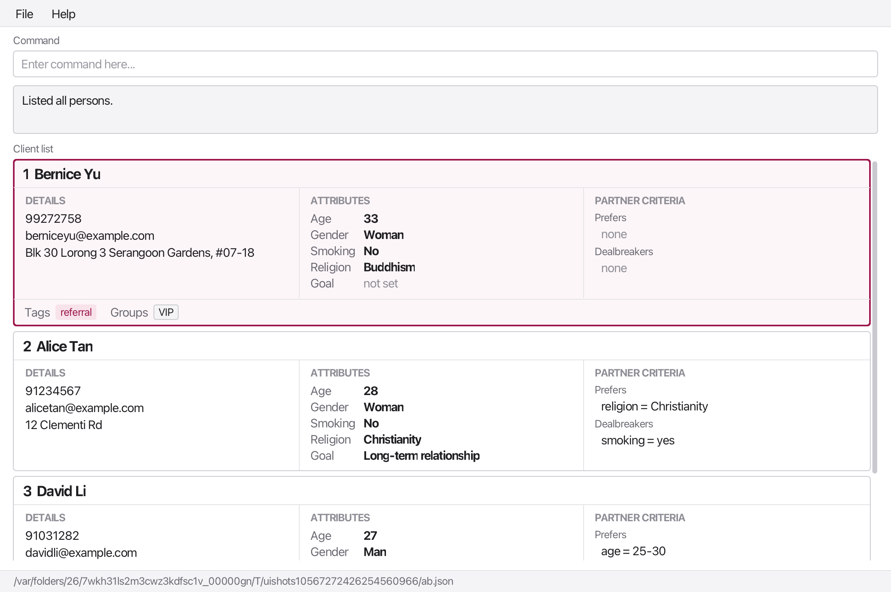

CupidMaxxing is a **desktop application for managing contacts, optimized for use through a Command Line Interface (CLI)** while retaining the benefits of a Graphical User Interface (GUI). CupidMaxxing helps independent matchmakers efficiently organize and retrieve client contact information, making it faster to identify relevant contacts and coordinate introductions between suitable clients.

* Table of Contents
{:toc}

--------------------------------------------------------------------------------------------------------------------

## Quick start

1. Ensure that Java `25` or later is installed on your computer. 
   **Mac users:** Ensure you have the precise JDK version prescribed [here](https://se-education.org/guides/tutorials/javaInstallationMac.html).

1. Download the latest `.jar` file from [here](https://github.com/AY2627S1-CS2103T-W09-1/tp/releases).

1. Copy the file to the folder you want to use as the _home folder_ for CupidMaxxing.

1. Open a terminal, `cd` to the folder containing the JAR file, and run `java -jar addressbook.jar`. 
   A GUI similar to the one below should appear in a few seconds. Note how the app contains some sample data. 
   

1. Type a command in the command box and press Enter to execute it. For example, type **`help`** and press Enter to open the help window. 
   Some example commands you can try:

   * `list` : Lists all contacts.

   * `add n/John Doe p/98765432 e/johnd@example.com a/John street, block 123, #01-01 age/25` : Adds a contact named `John Doe` to the Address Book.

   * `delete 3` : Deletes the 3rd contact shown in the current list.

   * `clear` : Deletes all contacts.

   * `exit` : Exits the app.

1. Refer to the [Features](#features) section below for details of each command.

--------------------------------------------------------------------------------------------------------------------

## Features

**:information_source: Notes about the command format:** 

* Words in `UPPER_CASE` are the parameters to be supplied by the user. 
  For example, in `add n/NAME`, replace `NAME` with a value such as `John Doe`.

* Items in square brackets are optional. 
  For example, `n/NAME [t/TAG]` can be used as `n/John Doe t/friend` or as `n/John Doe`.

* Items followed by `…`​ can appear zero or more times. 
  For example, `[t/TAG]…​` may be omitted, or written as `t/friend` or `t/friend t/family`.

* Parameters can be in any order. 
  For example, if the command specifies `n/NAME p/PHONE_NUMBER`, `p/PHONE_NUMBER n/NAME` is also acceptable.

* Extraneous parameters for commands that take no parameters, such as `help`, `list`, `exit`, and `clear`, are ignored. 
  For example, `help 123` is interpreted as `help`.

* If you are using a PDF version of this document, be careful when copying and pasting commands that span multiple lines as space characters surrounding line-breaks may be omitted when copied over to the application.

### Viewing help: `help`

Shows a message explaining how to access the help page.

Format: `help`

### Adding a client: `add`

Adds a client to CupidMaxxing with contact details and age. Gender, smoking status, religion and tags are optional.

Format: `add n/NAME p/PHONE_NUMBER e/EMAIL a/ADDRESS age/AGE [s/SMOKING] [g/GENDER] [rg/RELATIONSHIP_GOAL] [t/TAG]…​ [r/RELIGION] [{r/PREFERRED_RELIGION}] [<r/EXCLUDED_RELIGION>]`

* `AGE` is compulsory and must be an integer from 18 to 99 (inclusive).
* `g/GENDER` records the client's own gender: `m` (man), `w` (woman), or `nb` (non-binary). Values are case-insensitive and surrounding whitespace is ignored. Omit `g/` or leave it empty for unspecified gender. Only one value and one `g/` prefix are allowed per command.
* `rg/RELATIONSHIP_GOAL` is the client's own relationship goal. See [Relationship goal field](#relationship-goal-field) below.

The optional `s/SMOKING` field records the client's **own smoking habit**:
* Use `s/yes` for a smoker or `s/no` for a non-smoker. Values are case-insensitive; `s/YES` is accepted.
* Omit the field if the status is unknown. The person card displays `Smoking: Not specified`.
* A supplied `s/` must have a value, and may appear only once per command. Blank, invalid, or repeated values reject the command without changing any records.
* Smoking status is saved between sessions. Older records without this field remain usable and display `Not specified`.
* This field does not record a partner preference or dealbreaker. Smoking-based searching and matching are not implemented in this increment.

:bulb: **Tip:**
A person can have any number of tags, including zero.

Examples:
* `add n/John Doe p/98765432 e/johnd@example.com a/John street, block 123, #01-01 age/25`
* `add n/Betsy Crowe t/friend e/betsycrowe@example.com a/Newgate Prison p/1234567 age/30 t/criminal`
* `add n/Sarah Tan p/91234567 e/sarah@example.com a/12 Clementi Rd age/28 g/w` Records Sarah as a woman.
* `add n/Alice Tan p/91234567 e/alice@example.com a/Clementi age/30 s/no` Records Alice as a non-smoker.
* `add n/Priya Nair p/90001111 e/priya@example.com a/8 Tampines St age/28 rg/long` Records Priya as looking for a long-term relationship.

* `add n/Amy Bee p/85355255 e/amy@example.com a/Jurong West age/25 r/Jainism`

#### Religion fields

Religion is optional. Omit `r/` when a client's religion is not known; this is different from
`r/No religion`, which records an explicit answer. The accepted categories are
`Christianity`, `Islam`, `Hinduism`, `Buddhism`, `Sikhism`, `Judaism`, `Jainism`,
`Baha'i Faith`, `Shinto`, `Taoism`, `Confucianism`, `Zoroastrianism`, `Rastafari`,
`Wicca`, `Paganism`, `Tenrikyo`, `Cao Dai`, `Druze`, `Atheism`, `Agnosticism`, and
`No religion`. Use one of these names for `r/`.
Names are matched without regard to letter case or repeated spaces: for example,
`r/jAiNiSm` is accepted and displayed as `Jainism`. A misspelled name is not accepted;
use the listed spelling, although its letter case can vary. There is no free-text or
`Other` category. If none applies, leave the field unset rather than selecting
`No religion`, which means the client explicitly has no religion.

* `r/RELIGION` outside braces records the client's **own religion**, not a partner preference.
* `{r/RELIGION}` records a **soft partner preference**: a religion the client would like a partner to have.
* `<r/RELIGION>` records an **excluded partner religion** (a dealbreaker): the partner **must not have** this religion. It does not mean the partner must have it.
* Type the curly braces `{}` and angle brackets `<>` literally; square brackets in the format above only mark optional parts. For example, `r/Jainism {r/Buddhism} <r/Islam>` records own religion Jainism, a preference for Buddhism, and an exclusion of Islam.
* Each command may contain at most one preference environment `{...}` and one exclusion environment `<...>`. Environments cannot be nested. Supply at most one `r/` outside the environments and at most one `r/` inside each environment; a list of religions is not accepted.
* All three religion values use the same 21 categories and normalization above. A blank outer `r/` is rejected in `add`; a blank `r/` inside either environment is always rejected.
* The same normalized religion cannot be both preferred and excluded: `{r/Islam} <r/islam>` is rejected without changing records. The client's own religion is independent and may equal or differ from either partner criterion.
* Own religion and partner criteria are saved between sessions. The client's own religion is shown on the client card.
* The former partner-criteria prefixes `rp/`, `rr/`, and `rx/` are no longer supported. Commands containing them are rejected without changing records.
* `find r/RELIGION` searches only the client's own religion. Searching criteria environments and compatibility evaluation are not implemented; recording an exclusion does not run a matching command.

Example:
* `add n/Religion Demo p/91234567 e/religion@example.com a/Test Lane age/25 r/Jainism {r/Buddhism} <r/Islam>` Adds a 25-year-old client with the own religion, preference and exclusion described above. The required contact details and age are outside the environments.

#### Relationship goal field

The optional `rg/RELATIONSHIP_GOAL` field records what the client is **looking for**. The accepted
goals are adapted from Hinge. Type the short keyword for speed, or the full goal name; either way,
the full goal name is saved and shown on the client card:

Keyword | Relationship goal
--------|------------------
`life` | Life partner
`long` | Long-term relationship
`long-open` | Long-term relationship, open to short
`short-open` | Short-term relationship, open to long
`short` | Short-term fun
`unsure` | Figuring out my goals

* Keywords and goal names are matched without regard to letter case or repeated spaces: for example, `rg/LONG` and `rg/long-term   RELATIONSHIP` are both saved as `Long-term relationship`.
* Omit the field if the goal is not known. The client card then displays `Relationship goal: Not specified`. This is different from `rg/unsure`, which records that the client is still figuring out their goals.
* A supplied `rg/` may appear only once per command. Other values, such as `rg/marriage`, are rejected with the list of accepted keywords, and no records are changed.
* The relationship goal is saved between sessions. Older records without this field remain usable and display `Not specified`.
* This field does not record a partner preference or dealbreaker. Searching and matching by relationship goal are not implemented in this increment.

### Listing all clients: `list`

Shows a list of all clients in CupidMaxxing.

Format: `list`

### Editing a client: `edit`

Edits the client at `INDEX` in the currently displayed list. `INDEX` must be a positive integer.

Format: `edit INDEX [n/NAME] [p/PHONE] [e/EMAIL] [a/ADDRESS] [age/AGE] [s/SMOKING] [g/GENDER] [rg/RELATIONSHIP_GOAL] [t/TAG]…​ [r/RELIGION] [{r/PREFERRED_RELIGION}] [<r/EXCLUDED_RELIGION>]`

* Edits the person at the specified `INDEX`. The index refers to the index number shown in the displayed person list. The index **must be a positive integer** 1, 2, 3, …​
* At least one of the optional fields must be provided.
* Existing values will be updated to the input values.
* Use `g/m`, `g/w`, or `g/nb` to change gender; empty `g/` clears it, and omitting `g/` preserves it. Gender can be edited together with the other supported fields.
* If supplied, `AGE` must be an integer from 18 to 99 (inclusive).
* When editing tags, all of the person's existing tags are removed; adding tags is not cumulative.
* To remove all of a person's tags, enter `t/` without a tag after it.
* Use `s/yes` or `s/no` to update smoking status. Omitting `s/` preserves the existing status. Clearing a recorded smoking status through a command is not supported yet; an empty `s/` is rejected.
* Use outer `r/RELIGION` to update the client's own religion. Empty outer `r/` clears only the own religion; omitting it preserves it. Partner criteria and other contact details remain unchanged unless separately edited.
* Use `{r/RELIGION}` to set the preferred partner religion and `<r/RELIGION>` to set an excluded partner religion. The same validation rules as [Religion fields](#religion-fields) apply, including checking the resulting record for a religion that is both preferred and excluded.
* **A supplied environment replaces its entire bucket, not just its religion entry.** For example, editing with `{r/Buddhism}` removes any existing age, smoking or relationship-goal preferences in that preference bucket. Include all preferences you want to retain in the same `{...}` environment. The same replacement rule applies to the exclusion/dealbreaker bucket `<...>`.
* Omit an environment to preserve its entire bucket. Use `{}` to clear all preferences, or `<>` to clear all exclusions/dealbreakers. These do not clear the client's own religion. `{r/}` and `<r/>` are invalid, not clearing commands. A rejected edit leaves the whole record unchanged.
* The removed `rp/`, `rr/`, and `rx/` prefixes are rejected, including empty values.
* Use `rg/RELATIONSHIP_GOAL` to update the relationship goal. Omitting `rg/` preserves the existing goal, and `rg/` with no value clears it.

Examples:
*  `edit 1 p/91234567 e/johndoe@example.com` Edits the phone number and email address of the 1st person to be `91234567` and `johndoe@example.com` respectively.
*  `edit 2 n/Betsy Crower t/` Edits the name of the 2nd person to be `Betsy Crower` and clears all existing tags.
*  `edit 1 r/Christianity` Sets the client's own religion.
*  `edit 1 r/` Clears the client's own religion to unknown, preserving both partner-criteria buckets.
*  `edit 1 {r/Buddhism} <r/Islam>` Replaces all preferences with a preference for Buddhism and all exclusions with an exclusion of Islam; own religion and other client details are preserved.
*  `edit 1 {r/Buddhism age/25}` Replaces the entire preference bucket with religion Buddhism and age 25; any other existing preferences are removed, while exclusions are preserved.
*  `edit 1 {}` Clears all preferences, preserving exclusions and own religion.
*  `edit 1 <>` Clears all exclusions/dealbreakers, preserving preferences and own religion.
*  `edit 3 rg/short-open` Records the 3rd displayed client as looking for a short-term relationship, open to long, preserving their other details.
*  `edit 3 rg/` Clears the 3rd displayed client's relationship goal.

* `edit 1 g/nb` changes the first displayed client's gender to non-binary.
* `edit 1 g/` clears that client's gender.

### Finding clients: `find`

Search by name, age, or the client's own gender or religion. Each search examines the full client list and replaces the displayed results.

Formats:

* `find KEYWORD [MORE_KEYWORDS]` searches names. Matching is case-insensitive and uses whole words; a client is returned if any keyword matches.
* `find age/AGE` or `find age/MIN-MAX` searches an exact age or an inclusive range. Ages must be integers from 18 to 99, with no spaces within the range and `MIN` no greater than `MAX`.
* `find g/GENDER[,GENDER]…` returns clients matching any listed gender: `m`, `w`, or `nb`, in any order, ignoring case and surrounding whitespace.
* `find g/` returns every client with a specified gender, equivalent to `find g/m,w,nb`. Unspecified genders are excluded from gender searches.
* `find r/RELIGION` searches one of the supported [religion categories](#religion-fields), using the same case and whitespace normalization as `add` and `edit`. It matches the client's **own religion**, not partner criteria.
* A client with unknown religion does not match any religion search. `find r/No religion` matches only clients explicitly recorded as `No religion`, not those with an unset `r/`.
* A blank `r/`, an unsupported category, repeated `r/` prefixes or a list of religions are rejected. Partial category names do not match.

Use one search mode at a time. Name keywords, age, gender and religion criteria cannot be combined. Searches by smoking and combined-trait searches are not supported in this increment.

Use each prefix only once. Duplicate gender values (including `m,M`), unsupported values, and empty items such as `m,` or `m,,w` are rejected. Gender lists are supported only by `find`, not by `add` or `edit`. Commands and prefixes must be lowercase; separate each prefix from preceding text with a space. Invalid commands leave records and displayed results unchanged.

Examples:

* `find Alex Sam` finds clients whose names contain Alex or Sam.
* `find age/25-35` finds clients aged 25 to 35, inclusive.
* `find g/w` finds women.
* `find g/m,nb` finds men or non-binary clients.
* `find r/jAiNiSm` finds clients whose own religion is Jainism.
* `find r/Baha'i   Faith` finds clients recorded as Baha'i Faith, ignoring repeated spaces.
* `find r/No religion` finds clients who explicitly have no religion.

A valid search with no matches displays an empty result list and a count of zero.
Use `list` to show every client again; searching does not modify the stored records.

### Deleting a person: `delete'

Deletes the specified client from CupidMaxxing.

Format: `delete INDEX`

* Deletes the client at the specified `INDEX`.
* The index refers to the index number shown in the displayed client list.
* The index **must be a positive integer** 1, 2, 3, …​

Examples:
* `list` followed by `delete 2` deletes the 2nd client in CupidMaxxing.
* `find g/nb` followed by `delete 1` deletes the 1st client in the search results.

### Clearing all entries: `clear`

Clears all entries from the address book.

Format: `clear`

### Exiting the program: `exit`

Exits the program.

Format: `exit`

### Saving the data

CupidMaxxing automatically saves data after every successful command. You do not need to save manually. Gender is saved with each client; valid existing records without a gender load as unspecified. The existing required-age rule still applies.

The app's **home folder** is the folder containing its JAR, even if you launch it
from a different working folder. Keep that folder writable. Client data is stored
in `data/addressbook.json`, window preferences in `preferences.json`, and rotating
logs in `addressbook.log.*`, all inside that home folder. JavaFX runtime caches and
temporary files also stay there, in `.javafx/` and `.tmp/`. The app does not change
OS-level settings. Paths and symbolic links leading outside the home folder are
not supported for application data; move the data itself into the home folder instead.

### Editing the data file

CupidMaxxing data is saved automatically as a JSON file `[JAR file location]/data/addressbook.json`. Advanced users are welcome to update data directly by editing that data file.

Records with valid required fields but no own-religion property load with unknown
own religion, not `No religion`. Partner criteria are saved in the `preferences` and
`dealbreakers` maps: for example, `"preferences": {"religion": "Buddhism"}` and
`"dealbreakers": {"religion": "Islam"}`. The latter records an exclusion, not a requirement
to have Islam. Older valid records without these maps load with empty partner criteria.
Invalid religion values (including a null religion entry inside a criteria map), or the
same normalized religion in both maps, reject the file through the existing invalid-data
handling. A missing or null own-religion property still means unknown.
Obsolete `preferredReligion`, `requiredReligion`, and `excludedReligions` properties are
ignored when loading and omitted on the next save; they are not migrated into the new
maps. Valid own religion and other contact details are retained. Back up older development
data before migrating it; replace an obsolete `Other` religion only with an accurate
supported category, or remove that optional property if the religion is unknown.

:exclamation: **Caution:**
If your changes make the data file invalid, AddressBook starts with an empty address book at the next run. The invalid file remains on disk until you run a command (AddressBook saves after every command). Still, we recommend backing up the file before editing it. 
Furthermore, certain edits can cause the AddressBook to behave in unexpected ways (e.g., if a value entered is outside of the acceptable range). Therefore, edit the data file only if you are confident that you can update it correctly.

### Archiving data files `[coming in v2.0]`

_Details coming soon ..._

--------------------------------------------------------------------------------------------------------------------

## FAQ

**Q**: How do I transfer my data to another computer? 
**A**: Install the app on the other computer and overwrite the data file it creates with the data file from your previous AddressBook home folder.

--------------------------------------------------------------------------------------------------------------------

## Known issues

1. **When using multiple screens**, if you move the application to a secondary screen, and later switch to using only the primary screen, the GUI will open off-screen. The remedy is to delete the `preferences.json` file created by the application before running the application again.
2. **If you minimize the Help Window** and then run the `help` command (or use the `Help` menu, or the keyboard shortcut `F1`) again, the original Help Window will remain minimized, and no new Help Window will appear. The remedy is to manually restore the minimized Help Window.

--------------------------------------------------------------------------------------------------------------------

## Command summary

Action | Format, Examples
--------|------------------
**Add** | `add n/NAME p/PHONE_NUMBER e/EMAIL a/ADDRESS age/AGE [s/SMOKING] [g/GENDER] [rg/RELATIONSHIP_GOAL] [t/TAG]…​ [r/RELIGION] [{r/PREFERRED_RELIGION}] [<r/EXCLUDED_RELIGION>]`   e.g., `add n/James Ho p/22224444 e/jamesho@example.com a/123, Clementi Rd, 1234665 age/25 rg/long t/friend t/colleague`
**Clear** | `clear`
**Delete** | `delete INDEX`  e.g., `delete 3`
**Edit** | `edit INDEX [n/NAME] [p/PHONE_NUMBER] [e/EMAIL] [a/ADDRESS] [age/AGE] [s/SMOKING] [g/GENDER] [rg/RELATIONSHIP_GOAL] [t/TAG]…​ [r/RELIGION] [{r/PREFERRED_RELIGION}] [<r/EXCLUDED_RELIGION>]`  e.g., `edit 2 n/James Lee e/jameslee@example.com`
**Find** | `find KEYWORD [MORE_KEYWORDS]`, `find age/AGE`, `find age/MIN-MAX`, `find g/GENDER[,GENDER]…`, `find g/`, or `find r/RELIGION`  e.g., `find James Jake`, `find age/25-35`, `find g/m,nb`, `find r/Jainism`
**List** | `list`
**Help** | `help`
**Exit** | `exit`
